# Sem05-AppDev

In-class assignments and course projects for **Application Development**, Semester 5, at **Newton School of Technology, Rishihood University**.

| | |
|---|---|
| Author | Aryan Vibhuti |
| Course | Application Development (Semester 5) |
| College | Newton School of Technology, Rishihood University |
| Repository | [github.com/3ncryptor/Sem05-AppDev](https://github.com/3ncryptor/Sem05-AppDev) |
| Last updated | 2026-11-10 |

Facts in this README are cited to file paths in the repository. Each project's own README goes into more depth and is the place to start before running it.

## Summary

The repository holds three working applications, each built during class and each in its own folder under `inClass/`. They cover the three kinds of app the course has taught so far: a terminal program, a desktop app and a mobile app with a server. A terminal music player came first (August 2026), then Athena, a desktop exam app built with Electron (October 2026), then huddle., a mobile chat app built with Expo for the instructor's NestJS backend (November 2026). The `projects/` folder is reserved for graded projects and holds none yet.

The projects don't share code or dependencies, so you can run any one of them without the others. Each needs a different machine setup, and the requirements table below tells you whether your machine can run a project before you install anything.

## Projects

| Project | Folder | What it is | Stack | Start |
|---|---|---|---|---|
| CLI Music Player | [`inClass/CLI-Player`](inClass/CLI-Player) | A terminal music player with a playlist, a queue, volume and speed controls, and four animated visualizers | Node.js or Bun, `@opentui/core` 0.5, a small Objective-C audio engine on AVFoundation | `./setup.sh` |
| Athena | [`inClass/Proctor`](inClass/Proctor) | A desktop exam app: examiners build and run timed exams; students take them in fullscreen while webcam and screen screenshots are saved | Electron 44, React 19, Vite 8, Express 5, JSON files | `./start.sh` |
| huddle. | [`inClass/ChatApp`](inClass/ChatApp) | A mobile chat app (direct messages, groups, photos) with a built-in Inspector that shows every request travelling from the app to the server and database | Expo SDK 58 and React Native 0.88 in Expo Go; NestJS 11, Prisma 6 and MongoDB 7 in Docker | `npm run docker:up`, then `npx expo start` |

Source: `inClass/CLI-Player/package.json` and `setup.sh`; `inClass/Proctor/app/package.json`, `backend/package.json` and `start.sh`; `inClass/ChatApp/frontend/package.json`, `backend/package.json` and `backend/docker-compose.yml`.

## Architecture at a glance

<picture>
  <source media="(prefers-color-scheme: dark)" srcset="docs/diagrams/overview-dark.svg">
  
</picture>

Source: the figure in each project README, where every box is cited to a file.

The three projects move up in scale. The CLI player is one machine and two processes, joined by pipes and a small text protocol. Athena adds a privilege boundary: the page that shows the exam cannot touch the network, and a separate server holds the data. huddle. adds a real client and server split across two devices, with the server and its database in containers. The figure is animated: dots show data in flight. It follows GitHub's light or dark theme and stands still under reduced motion. Each project README has the detailed figures, a table of the system design concepts it uses, and step-by-step diagrams.

### System design concepts, by project

| Concept | CLI Music Player | Athena | huddle. |
|---|---|---|---|
| Client and server | | Electron app and Express server | Phone app and NestJS API |
| Process isolation | Native audio in its own process | Sandboxed renderer, privileged main process | |
| Inter-process communication | stdin and stdout pipes, text protocol | Allow-listed IPC through a preload script | |
| HTTP API | | REST with a `{ ok, data, error }` envelope | REST described by `swagger.json` |
| Authentication | | Bearer token, scrypt passwords, role checks | Basic auth checked on every request |
| Reliable delivery | | Durable answer queue with retries, idempotent server writes | Optimistic sends with retry |
| Keeping clients up to date | | Heartbeat every 10 s with server time | Polling every 3, 5 and 10 s |
| Storage | | JSON files with atomic writes | MongoDB through the Prisma ORM |
| Concurrency control | Background queue feeds the main queue | Per-attempt locks | One poll at a time per screen |
| Containers | | | Docker Compose, two services |
| Observability | | Request ids and one log line per request | Request ids from app to server logs, in-app Inspector |
| Graceful degradation | `afplay` when the native binary is missing | Offline banner while answers wait on disk | Works on the class server without the local extras |
| Design patterns | Event callbacks, render loop | Strategy pattern for scoring | Layered controller and service, dependency injection, publish and subscribe stores |

Source: the concepts table in each project README ([`inClass/CLI-Player`](inClass/CLI-Player/README.md#architecture), [`inClass/Proctor`](inClass/Proctor/README.md#architecture), [`inClass/ChatApp`](inClass/ChatApp/README.md#architecture)).

### How the figures are made

The animated figures are SVG files generated from one small spec per figure by [`tools/diagrams/build.mjs`](tools/diagrams/build.mjs), a Node.js script with no dependencies. The script writes a light and a dark version of each figure, with the same colours and legend everywhere. The animation is written inside the SVG, so it plays on GitHub, where scripts are not allowed. To change a figure, edit its spec in `tools/diagrams/specs/` and run `node tools/diagrams/build.mjs`. The step-by-step diagrams are Mermaid, which GitHub draws from the text in the README.

## What you need

All three projects were built and tested on macOS. The CLI player and Athena use Apple frameworks, so they only run on macOS. The chat app's server runs in Docker, so it should also run on Linux or Windows, but that has not been tried.

| | CLI Music Player | Athena | huddle. |
|---|---|---|---|
| Operating system | macOS | macOS on Apple Silicon | macOS (Docker host) plus an Android or iOS phone |
| Runtime | Bun (recommended) or Node.js | Node.js 22 or newer | Node.js for the app; Docker Desktop for the server |
| Extra tools | Xcode Command Line Tools (`clang` compiles the audio engine on first run) | `curl`, `lsof` (both ship with macOS) | Expo Go on the phone, signed in to an Expo account |
| Hardware | Speakers or headphones | A camera | Phone and Mac on the same Wi-Fi |

Source: `inClass/CLI-Player/setup.sh` lines 18-21; `inClass/Proctor/backend/package.json` (`engines`), `inClass/Proctor/start.sh`, `inClass/Proctor/app/package.json` (`dist` builds for `--arm64`); `inClass/ChatApp/backend/Dockerfile`, `inClass/ChatApp/README.md`.

## Quick start

```bash
git clone https://github.com/3ncryptor/Sem05-AppDev.git
cd Sem05-AppDev
```

Then pick one project and follow its README. The three shortest paths are:

```bash
# CLI Music Player: compiles the audio engine, asks Bun or Node, installs, starts
cd inClass/CLI-Player && ./setup.sh

# Athena: installs, seeds the database, starts the server, UI server and app window
cd inClass/Proctor && ./start.sh          # stop with ./stop.sh

# huddle.: the server in Docker (terminal 1), then the app in Expo Go (terminal 2)
cd inClass/ChatApp/backend && cp .env.example .env && npm run docker:up
cd inClass/ChatApp/frontend && npm install && npx expo start
```

You are done when the player draws its interface in the terminal, the Athena window shows its sign-in screen, or Expo Go on your phone shows the huddle. login screen.

## Repository layout

```
Sem05-AppDev/
  README.md                this file
  .gitignore               shared ignore rules (node_modules, .env, build output, the audio engine binary)
  inClass/                 work done during class
    CLI-Player/            terminal music player
    Proctor/               Athena desktop exam app (app/, backend/, docs/)
    ChatApp/               huddle. chat app (frontend/, backend/, swagger.json)
  projects/                graded course projects (none yet); its README is the template
  docs/diagrams/           the overview figure above (light and dark SVG)
  tools/diagrams/          the generator for every animated figure, and one spec per figure
```

## How the repository is kept

Every project carries its own README, and the larger ones also carry their plans and design notes: Athena has seven documents in `inClass/Proctor/docs/` and a design system in `inClass/Proctor/app/DESIGN.md`, and huddle. has `inClass/ChatApp/frontend/buildPlan.md` and `design.md`. Work happens on a branch and reaches `main` through a pull request; huddle. arrived that way in pull request #1.

Secrets are never committed. `.env` files are ignored by the root `.gitignore`, and projects that need settings ship a `.env.example` to copy (`inClass/ChatApp/backend/.env.example`). Dependencies are declared in each project's `package.json` with a committed lockfile, and `node_modules/` is never tracked. The CLI player's compiled `audio_player` binary is ignored too, so each machine builds it from `audio_player.m`.

## Caveats

The requirements above come from reading each project's scripts and package files on 2026-11-10, not from a fresh install on a clean machine. Older planning documents (`inClass/Proctor/BUILD_PLAN.md` and `SCREENS.md`, `inClass/CLI-Player/BuildPlan.md`) describe plans as they stood when they were written; each project README says which documents match the code today. The chat app's backend was written by the course instructor and extended here, and `inClass/ChatApp/README.md` lists the local additions. Pointed at the instructor's class server instead of the local Docker copy, the app works but those additions are missing.
