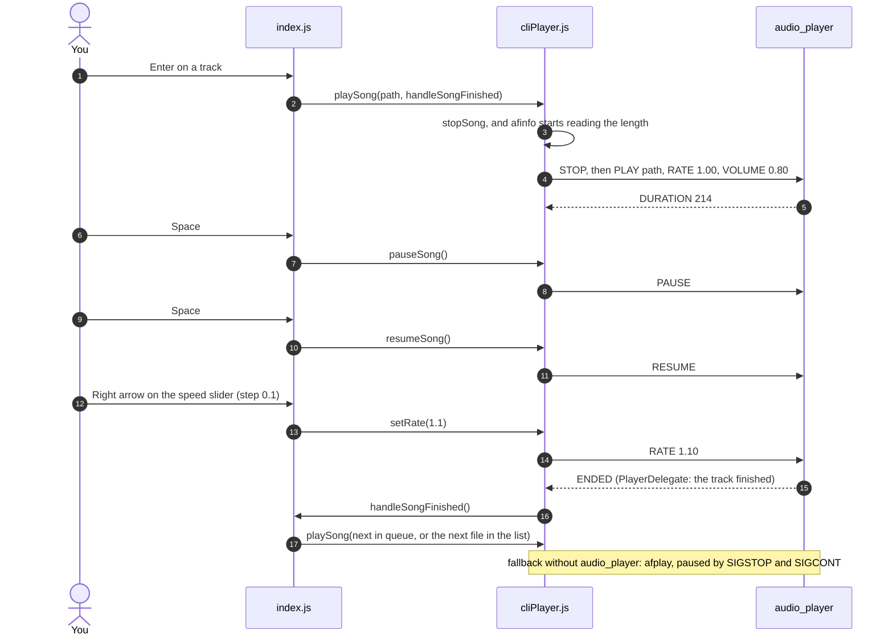
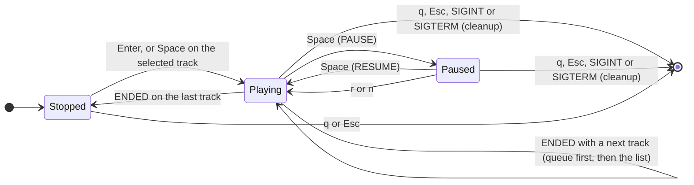

# CLI Music Player

An interactive Terminal User Interface (TUI) audio player built with Bun or Node.js and `@opentui/core` 0.5. It provides real-time playback control, track queuing, volume and speed mixing, and four animated visualizers. Audio plays in a separate native process that the player drives with one-line text commands over a pipe.

Part of [Sem05-AppDev](../../README.md). Built in class in August 2026; `WalkThrough.md` tells the story of how it was built, phase by phase.

---

## Architecture

The animated figure shows the two processes and the messages between them: a key press, the command it becomes, and the replies that come back. It follows GitHub's light or dark theme and stands still if your system asks for reduced motion. Every box names the file it comes from.

<picture>
  <source media="(prefers-color-scheme: dark)" srcset="docs/diagrams/processes-dark.svg">
  
</picture>

Source: `index.js` (renderer, key routing, the 100 ms render loop, `exitApplication`), `songs/cliPlayer.js` (`getWorker`, `playSong`, `pauseSong`, `resumeSong`, `setVolume`, `setRate`, `cleanupAllAudio`), `audio_player.m` (`handleCommand`, `PlayerDelegate`, `main`), `ui.js`, `setup.sh` lines 18-21.

The player is two processes. The terminal process (Bun or Node.js) owns everything the user sees: OpenTUI turns key presses into events, `index.js` routes them, `songs/cliPlayer.js` keeps the player state, and every 100 ms `ui.js` redraws the dashboard from that state. Sound lives in a second, native process, `audio_player`, written in Objective-C on AVFoundation. The two talk through the native process's standard streams with a small text protocol: one command per line on stdin (`PLAY <path>`, `PAUSE`, `RESUME`, `RATE <r>`, `VOLUME <v>`, `STOP`, `QUIT`), and replies on stdout. Node reads only two of the replies: `DURATION <s>` after a track loads, and `ENDED` when it finishes, which starts the next track in the queue.

Inside `audio_player`, a background queue reads stdin line by line and hands each command to the main queue, where a single `AVAudioPlayer` runs with `enableRate` on, so speed and volume change while a track plays. If the binary was never compiled, the player falls back to macOS `afplay`, one process per song. That process is paused with `SIGSTOP`, resumed with `SIGCONT` and stopped with `SIGKILL`, and its volume and speed are fixed when it starts. Track length comes from `afinfo` in both modes, and elapsed time is counted by a 1-second timer in `cliPlayer.js`. The visualizers are animations drawn from the player state, not from the audio samples.

### System design concepts used

| Concept | Where it shows | Code |
|---|---|---|
| Separate process for native code | Audio runs in `audio_player`, so a crash or hang there cannot freeze the terminal UI | `songs/cliPlayer.js` (`getWorker`), `audio_player.m` |
| Inter-process communication over pipes | stdin carries commands, stdout carries replies | `songs/cliPlayer.js`, `audio_player.m` (`main`) |
| A line-based text protocol | One command per line, a verb and an argument, easy to test by hand in a terminal | `audio_player.m` (`handleCommand`) |
| Producer and consumer threads | A background queue reads stdin; the main queue owns the player | `audio_player.m` (`dispatch_async`) |
| Event-driven callbacks | `ENDED` from the delegate starts the next track | `audio_player.m` (`PlayerDelegate`), `index.js` (`handleSongFinished`) |
| Render loop | The dashboard redraws from state at 10 frames a second | `index.js` (`refreshTimer`), `ui.js` |
| Graceful degradation | Without the binary, `afplay` still plays, pauses and queues | `songs/cliPlayer.js` (`playSong`, `pauseSong`, `resumeSong`) |
| Unix signals | `SIGSTOP` and `SIGCONT` pause the fallback; `SIGINT` and `SIGTERM` trigger cleanup | `songs/cliPlayer.js`, `index.js` |
| Clean shutdown, no orphan processes | On exit: `STOP`, `QUIT`, then `SIGKILL`, and `killall afplay` | `songs/cliPlayer.js` (`cleanupAllAudio`) |

<details>
<summary><b>Play, pause, resume, and what happens when a track ends</b></summary>



Source: `index.js` (key handler, `handleSongFinished`), `songs/cliPlayer.js` (`playSong`, `stopSong`, `pauseSong`, `resumeSong`, `setRate`, default `volume` 0.8 and `rate` 1.0), `audio_player.m`.

The example length (214 seconds) is an illustration. The commands, their order and the 0.1 speed step are the ones the code uses. The `PAUSED`, `RESUMED`, `RATE_SET`, `VOL_SET` and `STOPPED` replies are printed by `audio_player` but not read by Node, so they are left out.

</details>

<details>
<summary><b>Player states</b></summary>



Source: `index.js` (key handler, `handleSongFinished`, `exitApplication`), `songs/cliPlayer.js` (`isPlaying`, `isPaused`).

</details>

---

## Key Features

* **Multi-Mode Precision Audio Visualizers**: Toggleable on the fly with the `v` key, calibrated to 44 characters wide for zero line wrapping:
  * **Retro Hi-Fi Cassette Deck (Default)**: Features animated rotating tape spools (`◓ ◷ ◑ ◶ ◒ ◵ ◐ ◴`), dynamic magnetic tape transfer tracking (`░░█░░`), and active magnetic head state indicators.
  * **Cyberpunk Stereo Spectrum**: 20 high-density frequency sub-bands with gravity-decay peak caps (`▲`, `⬝`) and dual-channel VU meters.
  * **Laser Oscilloscope**: Multi-harmonic sinusoidal audio voltage waveform with envelope shaping.
  * **Cosmic Nebula Particle Matrix**: 2D acoustic transient matrix with radiant center pulsar and expanding shockwave rings.
* **Real-Time Dynamic Audio Mixing**:
  * **Master Volume**: Modulate song volume in real time from `0%` to `100%` without altering OS master volume.
  * **Dynamic Playback Speed**: Modulate tempo in real time from `0.5x` to `2.0x` with instant pitch/time-stretch engine response.
* **Queue & Playlist Management**: Windowed track pagination, enqueueing (`c` key), and automatic queue progression.
* **Clean OS Lifecycle Management**: Subscribes to `SIGINT`, `SIGTERM`, and `exit` hooks ensuring zero orphaned background audio processes.

---

## Keyboard Controls

Use `Tab` to switch active focus between the **Playlist** panel and the **Mixer & Equalizer** panel.

### Global Controls
| Key | Context | Action |
| :--- | :--- | :--- |
| `Space` | Global | Play / Pause / Resume current track |
| `v` | Global | Cycle visualizer mode (Spectrum, Oscilloscope, Nebula, Cassette) |
| `r` | Global | Reset track (restarts playback from `00:00`) |
| `n` | Global | Skip current song (plays next queued track) |
| `Tab` | Global | Toggle focus between Playlist and Mixer panels |
| `q` / `Esc` | Global | Stop playback and exit application cleanly |

### Panel-Specific Controls
| Active Panel | Key | Action |
| :--- | :--- | :--- |
| **Playlist** | `Up` / `Down` | Navigate through available tracks |
| **Playlist** | `Return` / `Enter` | Play selected track |
| **Playlist** | `c` | Add selected track to queue |
| **Mixer** | `Up` / `Down` | Toggle selection between Volume and Speed sliders |
| **Mixer** | `Left` / `Right` | Adjust selected slider value down / up |

---

## Project Structure

```
inClass/CLI-Player/
├── setup.sh              # Turnkey environment check, installation, and launch script
├── index.js              # Application entrypoint and keyboard input routing
├── ui.js                 # OpenTUI dashboard layout, widgets, and text builders
├── audio_player.m        # Native hardware audio driver (AVFoundation / CoreAudio)
├── audio_player          # Compiled by setup.sh on first run (gitignored, not in the repo)
├── package.json          # Project metadata, scripts, and dependencies
├── package-lock.json     # Dependency lockfile
├── BuildPlan.md          # Original feature roadmap (written before the build)
├── WalkThrough.md        # How the player was built, phase by phase
├── docs/diagrams/        # The animated architecture figure (light and dark)
├── README.md             # Project documentation
└── songs/
    ├── cliPlayer.js      # Audio controller and native IPC worker bridge
    ├── cliPlayer2.js     # Legacy synchronous playback reference
    └── *.mp3             # Four bundled sample tracks
```

The player loads `.mp3`, `.wav`, `.m4a`, `.aiff` and `.mp4` files from `songs/`, or from the folder you pass as the first argument (`index.js`, `songs/cliPlayer.js`).

---

## Installation & Usage

### Prerequisites
* **Host OS:** macOS (the audio engine uses AVFoundation, and track lengths come from `afinfo`).
* **Xcode Command Line Tools** (`xcode-select --install`): `setup.sh` compiles `audio_player.m` with `clang` on the first run. The binary is gitignored, so every fresh clone builds it. Without `clang` the player still runs on the `afplay` fallback described above.
* **JavaScript Runtime:** [Bun](https://bun.sh) (recommended; `setup.sh` notes that OpenTUI's native bindings are built for Bun) or **Node.js**.

### Option A: Turnkey Launch (Recommended)
Run the automated initialization and launch script (auto-detects Bun or Node.js, installs missing dependencies, and starts the player):
```bash
cd inClass/CLI-Player
./setup.sh
```

You can also pass a custom audio directory directly:
```bash
./setup.sh /path/to/music/folder
```

### Option B: Execution via Bun
```bash
cd inClass/CLI-Player

# 1. Install dependencies
bun install

# 2. Compile the audio engine (once; setup.sh does this for you)
clang -O2 -fobjc-arc -framework Foundation -framework AVFoundation audio_player.m -o audio_player

# 3. Launch player (note: plain `bun start` runs the npm "start" script, which uses Node)
bun run start:bun
# or directly:
bun run index.js
```

### Option C: Execution via Node.js / NPM
```bash
cd inClass/CLI-Player

# 1. Install dependencies
npm install

# 2. Compile the audio engine once (the clang command in Option B), then launch
npm start
```

