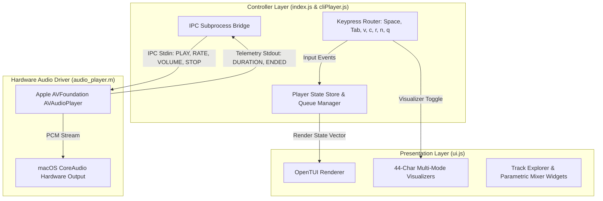

# CLI Music Player

An interactive Terminal User Interface (TUI) audio player built with Bun or Node.js and `@opentui/core` 0.5. It provides real-time playback control, track queuing, volume/speed mixing, and audio spectrum visualization by managing native macOS audio processes via POSIX signals.

Part of [Sem05-AppDev](../../README.md). Built in class in August 2026; `WalkThrough.md` tells the story of how it was built, phase by phase.

---

## Architecture Overview

The application follows a modular 3-tier architecture separating the presentation layer, controller bridge, and hardware audio driver:



* **UI Presentation Layer (`ui.js`)**: Encapsulates OpenTUI layout grids, border highlight states, widgets, and 4 precision 44-character visualizer renderers.
* **Controller Layer (`index.js` & `songs/cliPlayer.js`)**: Routes user keypress events, manages playlists and queues, and bridges commands to the audio worker over standard IO streams.
* **Hardware Audio Driver (`audio_player.m`)**: A native Objective-C helper compiled via `clang` utilizing Apple's `AVFoundation` framework, so playback speed and volume change while a track is playing. It reads `PLAY`, `RATE`, `VOLUME` and `STOP` commands on stdin and reports `DURATION` and `ENDED` on stdout (`songs/cliPlayer.js`).
* **Fallback**: If the compiled `audio_player` binary is missing, the player falls back to macOS `afplay` (`songs/cliPlayer.js`, `getWorker` and `playSong`). Playback, pause and the queue still work, but volume and speed changes only take effect when the next track starts. Track length is read with `afinfo` in both modes.

---

## Key Features

* **Multi-Mode Precision Audio Visualizers**: Toggleable on the fly with the `v` key, calibrated to 44 characters wide for zero line wrapping:
  * **Retro Hi-Fi Cassette Deck (Default)**: Features animated rotating tape spools (`◓ ◷ ◑ ◶ ◒ ◵ ◐ ◴`), dynamic magnetic tape transfer tracking (`░░█░░`), and active magnetic head state indicators.
  * **Cyberpunk Stereo Spectrum**: 20 high-density frequency sub-bands with gravity-decay peak caps (`▲`, `⬝`) and dual-channel VU meters.
  * **Laser Oscilloscope**: Multi-harmonic sinusoidal audio voltage waveform with envelope shaping.
  * **Cosmic Nebula Particle Matrix**: 2D acoustic transient matrix with radiant center pulsar and expanding shockwave rings.
* **Real-Time Dynamic Audio Mixing**:
  * **Master Volume**: Modulate song volume in real time from `0%` to `100%` without altering OS master volume.
  * **Dynamic Playback Speed**: Modulate tempo in real time from `0.5x` to `2.0x` with instant pitch/time-stretch engine response.
* **Queue & Playlist Management**: Windowed track pagination, enqueueing (`c` key), and automatic queue progression.
* **Clean OS Lifecycle Management**: Subscribes to `SIGINT`, `SIGTERM`, and `exit` hooks ensuring zero orphaned background audio processes.

---

## Keyboard Controls

Use `Tab` to switch active focus between the **Playlist** panel and the **Mixer & Equalizer** panel.

### Global Controls
| Key | Context | Action |
| :--- | :--- | :--- |
| `Space` | Global | Play / Pause / Resume current track |
| `v` | Global | Cycle visualizer mode (Spectrum, Oscilloscope, Nebula, Cassette) |
| `r` | Global | Reset track (restarts playback from `00:00`) |
| `n` | Global | Skip current song (plays next queued track) |
| `Tab` | Global | Toggle focus between Playlist and Mixer panels |
| `q` / `Esc` | Global | Stop playback and exit application cleanly |

### Panel-Specific Controls
| Active Panel | Key | Action |
| :--- | :--- | :--- |
| **Playlist** | `Up` / `Down` | Navigate through available tracks |
| **Playlist** | `Return` / `Enter` | Play selected track |
| **Playlist** | `c` | Add selected track to queue |
| **Mixer** | `Up` / `Down` | Toggle selection between Volume and Speed sliders |
| **Mixer** | `Left` / `Right` | Adjust selected slider value down / up |

---

## Project Structure

```
inClass/CLI-Player/
├── setup.sh              # Turnkey environment check, installation, and launch script
├── index.js              # Application entrypoint and keyboard input routing
├── ui.js                 # OpenTUI dashboard layout, widgets, and text builders
├── audio_player.m        # Native hardware audio driver (AVFoundation / CoreAudio)
├── audio_player          # Compiled by setup.sh on first run (gitignored, not in the repo)
├── package.json          # Project metadata, scripts, and dependencies
├── package-lock.json     # Dependency lockfile
├── BuildPlan.md          # Original feature roadmap (written before the build)
├── WalkThrough.md        # How the player was built, phase by phase
├── README.md             # Project documentation
└── songs/
    ├── cliPlayer.js      # Audio controller and native IPC worker bridge
    ├── cliPlayer2.js     # Legacy synchronous playback reference
    └── *.mp3             # Four bundled sample tracks
```

The player loads `.mp3`, `.wav`, `.m4a`, `.aiff` and `.mp4` files from `songs/`, or from the folder you pass as the first argument (`index.js`, `songs/cliPlayer.js`).

---

## Installation & Usage

### Prerequisites
* **Host OS:** macOS (the audio engine uses AVFoundation, and track lengths come from `afinfo`).
* **Xcode Command Line Tools** (`xcode-select --install`): `setup.sh` compiles `audio_player.m` with `clang` on the first run. The binary is gitignored, so every fresh clone builds it. Without `clang` the player still runs on the `afplay` fallback described above.
* **JavaScript Runtime:** [Bun](https://bun.sh) (recommended; `setup.sh` notes that OpenTUI's native bindings are built for Bun) or **Node.js**.

### Option A: Turnkey Launch (Recommended)
Run the automated initialization and launch script (auto-detects Bun or Node.js, installs missing dependencies, and starts the player):
```bash
cd inClass/CLI-Player
./setup.sh
```

You can also pass a custom audio directory directly:
```bash
./setup.sh /path/to/music/folder
```

### Option B: Execution via Bun
```bash
cd inClass/CLI-Player

# 1. Install dependencies
bun install

# 2. Compile the audio engine (once; setup.sh does this for you)
clang -O2 -fobjc-arc -framework Foundation -framework AVFoundation audio_player.m -o audio_player

# 3. Launch player (note: plain `bun start` runs the npm "start" script, which uses Node)
bun run start:bun
# or directly:
bun run index.js
```

### Option C: Execution via Node.js / NPM
```bash
cd inClass/CLI-Player

# 1. Install dependencies
npm install

# 2. Compile the audio engine once (the clang command in Option B), then launch
npm start
```

