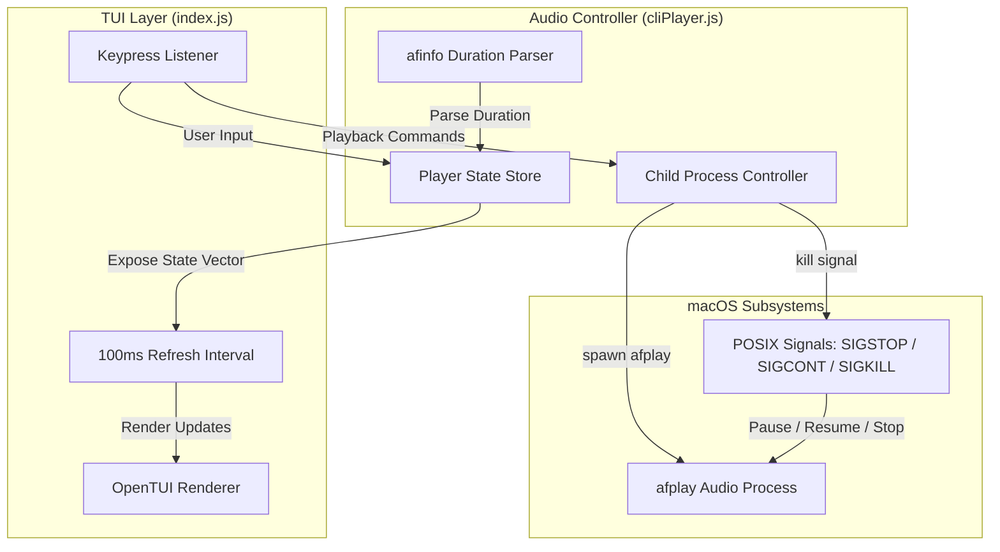

# CLI Music Player

An interactive Terminal User Interface (TUI) audio player built with Node.js and `@opentui/core`. It provides real-time playback control, track queuing, volume/speed mixing, and audio spectrum visualization by managing native macOS audio processes via POSIX signals.

---

## Architecture Overview

The application follows a decoupled architecture separating the presentation layer from the audio control process:



* **UI Layer (`index.js`)**: Manages the OpenTUI layout grid, border styles, text renderables, focus states, and user keypress events.
* **Audio Layer (`songs/cliPlayer.js`)**: Scans directories for supported audio formats, spawns child processes running `afplay`, parses song length via `afinfo`, and manipulates playback states using OS signals.

---

## Key Features

* **POSIX Signal Control**: Employs non-blocking process management to control audio execution directly:
  * `SIGSTOP`: Pauses playback by suspending the `afplay` process.
  * `SIGCONT`: Resumes playback by continuing the suspended process.
  * `SIGKILL`: Immediately terminates the process on track switch or application exit.
* **Duration Parsing & Telemetry**: Uses `afinfo` on file load to retrieve the exact duration in seconds, computing live progress indicators and elapsed time trackers.
* **Dynamic Audio Mixer**: Modifies playback attributes in real-time:
  * **Volume Gain**: Adjustable from `0.0` to `1.5`.
  * **Playback Rate**: Adjustable from `0.5x` to `2.0x` speed.
* **Spectrum Visualizer**: Generates a live, symmetrical frequency bar animation rendered at 10 FPS.
* **Queue & Playlist Management**: Browse loaded audio files, append items to an active queue, and auto-advance to the next queued track on song completion.

---

## Keyboard Controls

Use `Tab` to switch active focus between the **Playlist** panel and the **Mixer & Equalizer** panel.

### Global Controls
| Key | Context | Action |
| :--- | :--- | :--- |
| `Space` | Global | Play / Pause / Resume current track |
| `r` | Global | Reset track (restarts playback from `00:00`) |
| `n` | Global | Skip current song (plays next queued track) |
| `Tab` | Global | Toggle focus between Playlist and Mixer panels |
| `q` / `Esc` | Global | Stop playback and exit application cleanly |

### Panel-Specific Controls
| Active Panel | Key | Action |
| :--- | :--- | :--- |
| **Playlist** | `Up` / `Down` | Navigate through available tracks |
| **Playlist** | `Return` / `Enter` | Play selected track |
| **Playlist** | `c` | Add selected track to queue |
| **Mixer** | `Up` / `Down` | Toggle selection between Volume and Speed sliders |
| **Mixer** | `Left` / `Right` | Adjust selected slider value down / up |

---

## Project Structure

```
inClass/CLI-Player/
├── setup.sh              # Turnkey environment check, installation, and launch script
├── index.js              # TUI layout, render loop, and input handling
├── package.json          # Project metadata, scripts, and dependencies
├── package-lock.json     # Dependency lockfile
├── BuildPlan.md          # Feature roadmap and implementation notes
├── README.md             # Project documentation
└── songs/
    ├── cliPlayer.js      # Audio process controller and signal manager
    ├── cliPlayer2.js     # Legacy synchronous playback reference
    └── *.mp3             # Bundled sample audio files
```

---

## Installation & Usage

### Prerequisites
* **Host OS:** macOS (Required for native `afplay` and `afinfo` commands).
* **JavaScript Runtime:** [Bun](https://bun.sh) (recommended for high-performance OpenTUI execution) or **Node.js** (v18.0.0+).

### Option A: Turnkey Launch (Recommended)
Run the automated initialization and launch script (auto-detects Bun or Node.js, installs missing dependencies, and starts the player):
```bash
cd inClass/CLI-Player
./setup.sh
```

You can also pass a custom audio directory directly:
```bash
./setup.sh /path/to/music/folder
```

### Option B: Execution via Bun
```bash
cd inClass/CLI-Player

# 1. Install dependencies
bun install

# 2. Launch player
bun start
# or directly:
bun run index.js
```

### Option C: Execution via Node.js / NPM
```bash
cd inClass/CLI-Player

# 1. Install dependencies
npm install

# 2. Launch player
npm start
```

