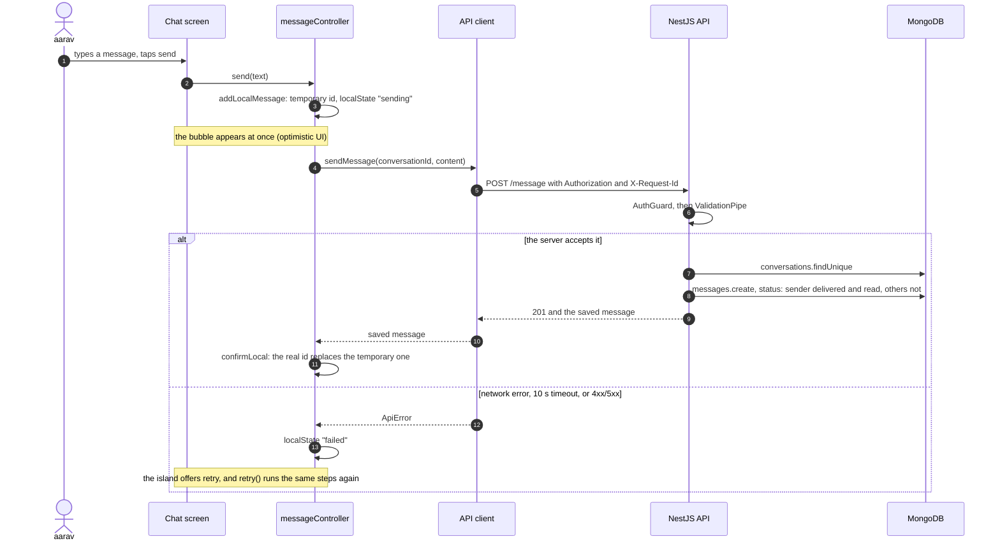
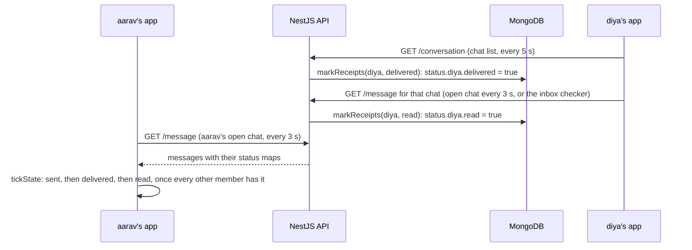
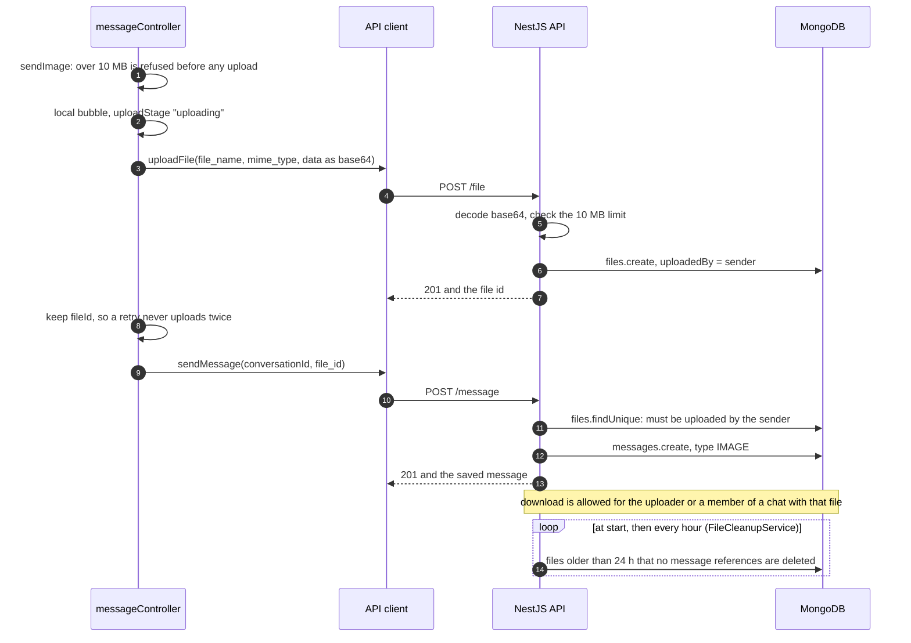
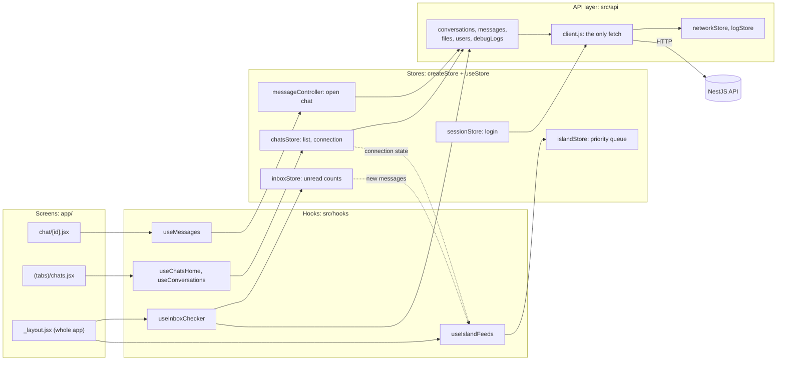
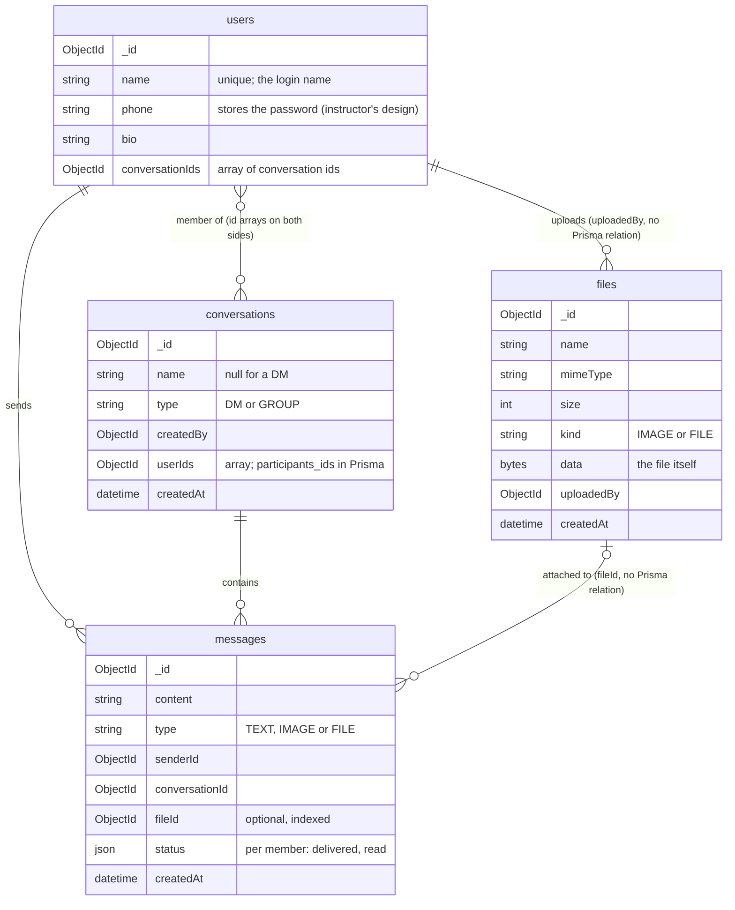
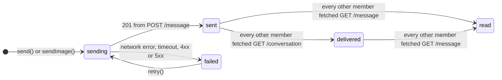
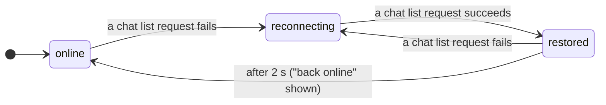

# ChatApp: huddle.

A mobile chat app built in class: an Expo React Native app called **huddle.** in `frontend/`, talking to the course instructor's NestJS chat server in `backend/`.

Compiled 2026-11-10. Facts are cited to file paths in this folder. Mermaid diagrams render on GitHub.

## Summary

huddle. is a chat app for phones. It does direct messages, group chats and photo messages, and it shows new messages in a notch island at the top of the screen. It runs in Expo Go (SDK 58) on Android or iOS, so nothing has to be built or installed on the phone except Expo Go itself. The server is the instructor's NestJS 11 backend, with Prisma 6 over MongoDB 7, and it runs on your Mac in Docker. A copy of the same backend runs on the instructor's class server, and the app can switch between the two from its login screen.

The project is also a teaching tool. Its built-in **Inspector** shows every request the app makes as it travels from the phone through the network to the NestJS server and into MongoDB. It explains each one twice, first as a plain sentence and then with the exact method, path, headers, payload, reply and timing. It was built for the class viva, so a reader can see the architecture working instead of taking it on trust.

The contract between the two halves is `swagger.json`, the instructor's API description. The app only uses the routes listed there. The local backend adds four things on top (read receipts, a log feed for the Inspector, cleanup of unsent uploads and demo data), and none of them changes a route or a response shape. That is why the same app works against both servers.

## Architecture

The two animated figures below show the whole system and then one request travelling through it. The dots move along the real paths: in the first figure, request dots keep the app's real polling rhythm. The figures follow GitHub's light or dark theme, and they stand still if your system asks for reduced motion. The diagrams after them each open one mechanism step by step. Every box names the file it comes from, so each claim can be checked in the code.

### The whole system

<picture>
  <source media="(prefers-color-scheme: dark)" srcset="docs/diagrams/system-dark.svg">
  
</picture>

Source: `backend/docker-compose.yml`, `backend/Dockerfile`, `frontend/src/constants/config.js` (`POLL_MS`), `frontend/src/api/client.js`, `frontend/src/api/baseUrl.js`, `frontend/src/store/persist.js`, `backend/src/file/file-cleanup.service.ts`, `backend/src/bot/bot.service.ts`.

The phone holds the whole app. Expo Go downloads the JavaScript bundle from Metro on the Mac (port 8081) and runs it. Screens read small stores, the stores decide when to poll, and every request leaves through one API client. The Mac runs two containers on one private Docker network: the API on port 3000 and MongoDB on port 27017. The API reaches the database by the host name `mongo`, and the database files live in two named volumes, so they survive a restart. MongoDB runs as a single-node replica set because Prisma needs one for MongoDB. Inside the API process, a timer deletes uploads that were never sent in a message, and an optional bot posts facts every 10 seconds. On the class server the same routes exist, but the local additions (receipts, the log feed) do not.

### One request, end to end

<picture>
  <source media="(prefers-color-scheme: dark)" srcset="docs/diagrams/request-dark.svg">
  
</picture>

Source: `backend/src/main.ts` (middleware order, global pipe and filter), `backend/src/auth/auth.module.ts` and `auth.guard.ts`, `backend/src/message/message.controller.ts` and `message.service.ts`, `backend/src/common/` (`request-logger.middleware.ts`, `request-context.ts`, `log-buffer.ts`, `logging-exception.filter.ts`), `frontend/src/store/messageController.js`, `frontend/src/api/client.js`, `frontend/src/hooks/useServerLogs.js`.

The numbers are the order the code runs. Steps 1 to 3 are Express middleware that `main.ts` registers with `app.use`, in that order. Step 4 is Nest's guard stage: `AuthGuard` is registered globally through `APP_GUARD`, so no route can skip it. Step 5 is the global `ValidationPipe`, which turns the body into a `CreateMessageDto` and rejects any field the DTO does not declare. Steps 6 and 7 are the usual controller and service split: the controller only maps HTTP to a method call, and the service holds the rules. The sender is taken from the authenticated user, never from the body. Prisma (step 8) is the only code that talks to MongoDB.

Two things make the request observable. The app sends an `X-Request-Id` header, and `requestContext` keeps it in `AsyncLocalStorage`, so every log line written while handling that request carries the same id without passing it around. The logger also keeps the last 500 lines in memory, and the Inspector fetches them every 2 seconds while it is open, which lets it match server lines to its own requests.

### System design concepts used

| Concept | Where it shows | Code |
|---|---|---|
| Client-server over REST | The app uses the 9 routes in `swagger.json`; the server holds all shared state | `swagger.json`, `frontend/src/api/` |
| Stateless authentication on every request | No session: each request carries `Basic name:password`, and the guard checks it again | `backend/src/auth/auth.guard.ts` |
| Polling instead of push | 3 s open chat, 5 s chat list, 10 s inbox round; paused when the app is in the background | `frontend/src/constants/config.js`, `frontend/src/hooks/usePolling.js` |
| No overlapping polls | A poll that is still running skips the next tick | `frontend/src/utils/poller.js` |
| Back-off per chat | A chat that keeps failing is checked less often, without slowing the others | `frontend/src/inbox/inboxChecker.js`, `inboxLogic.js` |
| Optimistic UI | The bubble shows before the server answers, then is confirmed or marked failed | `frontend/src/store/messageController.js` |
| Cursor pagination | 20 messages a page; the oldest id on the page is the cursor for the next | `backend/src/message/message.service.ts` |
| Idempotent DM creation | Asking for a DM that exists returns the existing one | `backend/src/conversation/conversation.service.ts` |
| Layered backend with dependency injection | Module, controller, service, Prisma; Nest injects `PrismaService` | `backend/src/*/*.module.ts` |
| Cross-cutting concerns in one place | Global guard, global validation pipe, global exception filter | `backend/src/main.ts`, `auth.module.ts` |
| ORM | Typed queries and one schema file for four collections | `backend/prisma/schema.prisma` |
| Containers and service discovery | Two containers, health check before the API starts, host name `mongo` | `backend/docker-compose.yml` |
| Correlation ids and observability | `X-Request-Id` on every request and every server log line | `frontend/src/api/client.js`, `backend/src/common/request-context.ts` |
| Secrets kept out of logs | Passwords and the `Authorization` header are never printed or shown | `backend/src/common/request-logger.middleware.ts`, `frontend/src/debug/networkDetail.js` |
| Background job | Hourly removal of uploads no message uses | `backend/src/file/file-cleanup.service.ts` |
| Priority queue | The island shows the most important live activity first, two more as circles | `frontend/src/island/islandQueue.js` |
| One-way data flow without Context | Stores are plain publish and subscribe objects; screens read them with `useStore` | `frontend/src/store/createStore.js`, `frontend/src/hooks/useStore.js` |
| Graceful degradation | On the class server the app works without receipts or server logs | `frontend/src/debug/serverLogsState.js` |

<details>
<summary><b>Sending a message, step by step</b></summary>



Source: `frontend/src/store/messageController.js` (`send`, `deliver`, `retry`), `frontend/src/api/client.js`, `backend/src/message/message.service.ts` (`createMessage`), `frontend/app/chat/[id].jsx` (`islandFailed`).

How the ticks change afterwards. Receipts are a local addition: the class server never changes `status`, so ticks stay at "sent" there.



Source: `backend/src/common/receipts.util.ts`, `backend/src/conversation/conversation.service.ts` (`getUserConversations`), `backend/src/message/message.service.ts` (`getMessages`), `frontend/src/utils/ticks.js`.

</details>

<details>
<summary><b>Sending a photo, and what happens to unsent uploads</b></summary>



Source: `frontend/src/store/messageController.js` (`sendImage`, `ensureUploaded`), `backend/src/file/file.service.ts` (`loadAccessibleFile`, `wasSharedWith`), `backend/src/file/file-content.util.ts` (`MAX_FILE_BYTES`), `backend/src/message/message.service.ts` (`loadOwnFile`), `backend/src/file/file-cleanup.service.ts`.

</details>

<details>
<summary><b>Inside the app: screens, hooks, stores and the API layer</b></summary>



Source: `frontend/app/_layout.jsx`, `frontend/app/(tabs)/chats.jsx`, `frontend/app/chat/[id].jsx`, `frontend/src/hooks/`, `frontend/src/store/`, `frontend/src/inbox/inboxStore.js`, `frontend/src/island/islandStore.js`, `frontend/src/api/client.js`.

The app does not use React Context or reducers. Each store is a small publish and subscribe object (`createStore`), screens read it through `useStore`, and plain modules update it, so the logic can be tested without React. Only `client.js` calls `fetch`, which is why every request can carry the same headers, be timed out the same way and appear in the Inspector.

</details>

<details>
<summary><b>Data model</b></summary>



Source: `backend/prisma/schema.prisma`.

MongoDB has no joins in the SQL sense, so the many-to-many link between users and conversations is two arrays of ids that Prisma keeps as a relation. `messages.fileId` and `files.uploadedBy` are plain ids with no Prisma relation; the service checks them in code (`loadOwnFile`, `wasSharedWith`). Files are stored inside MongoDB as bytes, which is why uploads are capped at 10 MB. The password is kept in plain text in the `phone` field. That is how the instructor's server works, and it is one reason not to use a real password here.

</details>

<details>
<summary><b>Message ticks and the connection state</b></summary>



Source: `frontend/src/store/messageController.js`, `frontend/src/utils/ticks.js` (`tickState`), `backend/src/common/receipts.util.ts`.



Source: `frontend/src/utils/connectionState.js` (`nextConnectionState`), `frontend/src/store/chatsStore.js` (`moveConnection`, `RESTORED_BANNER_MS` = 2000).

"Read" means the member's app fetched that chat's messages, and that includes the inbox checker's background check. So on the local backend a message can turn read within one inbox round (about 10 seconds) even if the chat was never opened on screen.

</details>

Every request carries `Authorization: Basic <username>:<password>`, with the username and password in plain text and not base64-encoded. The server creates the user the first time it sees a new username (`backend/src/auth/auth.guard.ts`). The backend has no push channel, so the app polls instead. The open chat refreshes every 3 seconds and the chat list every 5. An inbox checker goes through every chat in turn, and one full round takes 10 seconds (`frontend/src/constants/config.js`, `POLL_MS`). The app finds your Mac's backend automatically from the address Expo Go connected to (`frontend/src/api/baseUrl.js`), so you never type an IP for the local server.

## Quick start

You need macOS with Docker Desktop and Node.js, and a phone with Expo Go on the same Wi-Fi as the Mac.

```bash
# Terminal 1: the server (from inClass/ChatApp/backend)
cp .env.example .env
npm run docker:up                      # MongoDB + API; leave it running

# Terminal 2: demo data, once (from anywhere)
docker exec chatapp_api npm run seed   # users aarav, diya, kabir, meera, rohan; password demo123

# Terminal 2: the app (from inClass/ChatApp/frontend)
npm install
npx expo start                         # scan the QR code with Expo Go
```

Expo Go asks you to sign in to an Expo account before it opens a project, so do that first. The first time the phone connects, macOS may ask whether Node or Docker can accept incoming connections. Allow it, or the phone cannot reach port 3000. Log in as `aarav` with password `demo123`.

You are done when `http://localhost:3000/docs` shows the Swagger page on the Mac and the app opens on the Chats screen with aarav's two direct messages (diya, kabir) and the "Study Group". To use the class server instead, choose **class server** on the login screen, type the address your teacher gives you (for example `http://10.7.1.51:3000`) and tap **test**.

## What is in each half

| Part | What it does | Where to read more |
|---|---|---|
| App screens | Login (local or class server), Chats with a groups carousel and unread badges, a chat with text and photos, People with search and New group, Profile with avatar style, appearance and the Inspector | `frontend/app/`, [`frontend/README.md`](frontend/README.md) |
| Notch island | A pill around the front camera that shows new messages with quick reply, reconnecting, uploads, failed sends and confirmations, with tap, hold and swipe actions | `frontend/src/island/`, `frontend/src/components/island/` |
| Inspector | Five tabs (overview, flow, network, logs, tools) that show every request from the app to the server and the database | `frontend/src/debug/`, `frontend/src/components/inspector/` |
| API | Users, conversations, messages and files, with cursor pagination and auth on every route | `backend/src/{user,conversation,message,file,auth}/`, [`swagger.json`](swagger.json) |
| Data | Four Prisma models: `User`, `Conversation`, `Message`, `File` | `backend/prisma/schema.prisma` |
| Server extras | Read receipts, the log feed, upload cleanup, FactBot simulation, demo seed | `backend/src/{common,debug,bot}/`, `backend/prisma/seed.ts` |

Source: `frontend/app/`, `frontend/src/`, `backend/src/`, `backend/prisma/schema.prisma`.

## The API in one table

| Method | Path | What it does |
|---|---|---|
| `GET` | `/user` | Every registered user |
| `GET` | `/user/profile` | One user's profile; your own without `user_id` |
| `POST` | `/conversation` | Create a DM or group; returns the existing DM if there already is one |
| `GET` | `/conversation` | Your conversations |
| `POST` | `/message` | Send text, an attachment (`file_id`) or both |
| `GET` | `/message` | A conversation's history, page by page |
| `POST` | `/file` | Upload base64 (up to 10 MB); returns the `id` to send as `file_id` |
| `GET` | `/file/{id}` | A file's metadata and base64 contents |
| `GET` | `/file/{id}/download` | The raw bytes |
| `GET` | `/debug/logs` | Local only: recent server log lines for the Inspector (not in `swagger.json`) |

Source: `swagger.json` (`paths`), `backend/src/debug/debug.controller.ts`. Full request and response shapes are at `http://localhost:3000/docs` while the server runs.

## Local backend versus the class server

The backend in `backend/` started as the instructor's code, synced to the class `swagger.json` (commit 05aeac6, 2026-11-10). The additions below were made here, and each one keeps every route and response the same. `backend/README.md` describes them in full.

| Addition | Effect | Setting |
|---|---|---|
| Read receipts | Fetching conversations marks your messages delivered; opening a chat marks its messages read | always on |
| Server log feed | `GET /debug/logs` serves the last 500 log lines so the Inspector can show what the server did | `DEBUG_LOGS=true` (default in Docker) |
| Upload cleanup | Files uploaded but never sent in a message are deleted | `FILE_ORPHAN_TTL_HOURS=24` |
| Demo data | Five users, three DMs and a group with an image | `npm run seed` |
| Request logging | One readable line per request in `docker logs -f chatapp_api`, passwords never printed | always on |

Source: `backend/.env.example`, `backend/docker-compose.yml`, `git log -- backend`.

On the class server none of these exist. The app still works there, and the Inspector says "server logs unavailable here". It also labels the backend and database steps "from the code", because it is describing this repository's backend code rather than live server output.

## Folder layout

```
ChatApp/
  README.md          this file
  swagger.json       the instructor's API contract (OpenAPI)
  graphify.sh        rebuilds a code graph of both halves into graphify-out/ (ignored by git)
  docs/diagrams/     the animated architecture figures (built by tools/diagrams at the repository root)
  backend/           NestJS + Prisma + MongoDB, run with Docker Compose
    src/             one module per resource, plus auth, bot, debug and common (logging)
    prisma/          schema.prisma and seed.ts
  frontend/          Expo app (huddle.)
    app/             screens, one file per route (Expo Router)
    src/             api, store, hooks, inbox, island, debug, components, utils
    buildPlan.md     the plan: screens, flows, build order, decisions
    design.md        the design system: colour, type, motion
```

## Documentation and further reading

1. [`frontend/README.md`](frontend/README.md): running the app, its scripts, the code rules, the island gestures, the Inspector tabs and a phone checklist.
2. [`backend/README.md`](backend/README.md): running the server with and without Docker, environment settings, logging and the local additions.
3. [`frontend/buildPlan.md`](frontend/buildPlan.md): how the app was planned and built, section by section.
4. [`frontend/design.md`](frontend/design.md): the "soft slab" design system.
5. [`swagger.json`](swagger.json): the API contract; open it in any OpenAPI viewer, or see it live at `/docs`.

## When something goes wrong

If the app says it cannot reach the server, the phone and the Mac are usually on different networks, or the macOS firewall blocked port 3000. Check `curl http://localhost:3000/user -H 'Authorization: Basic aarav:demo123'` on the Mac first: if that answers, the problem is between phone and Mac. If `npm run docker:up` fails because port 3000 or 27017 is taken, stop whatever holds it (Athena's backend in `inClass/Proctor` also uses port 3000). `npm run docker:down`, `docker:logs` and `docker:up:bot` call the older `docker-compose` command, while `docker:up` calls `docker compose`. If your Docker install only has the newer one, run `docker compose down` and `docker compose logs -f api` directly.

## Caveats

The server is open by design. It is meant for about 200 students on one classroom network. Passwords travel in plain text over HTTP and any new username creates an account, so do not reuse a real password. Unread counts are kept on the phone, because the instructor's API has no per-user read state. The 10-second message delay comes from polling and is not a bug. The Expo Go sign-in requirement comes from Expo's announcements rather than a test on every device. The project has been checked on phones through Expo Go only. No standalone build (APK or IPA) has been made or tested, because sharing a release was dropped for now (`frontend/buildPlan.md`, section 16).
