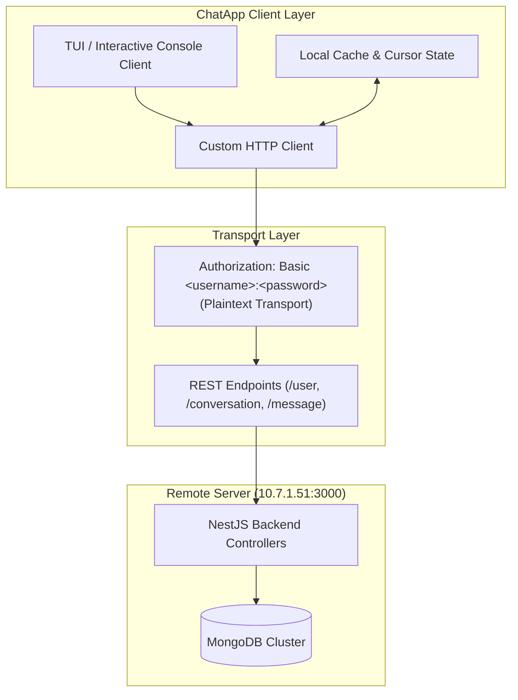
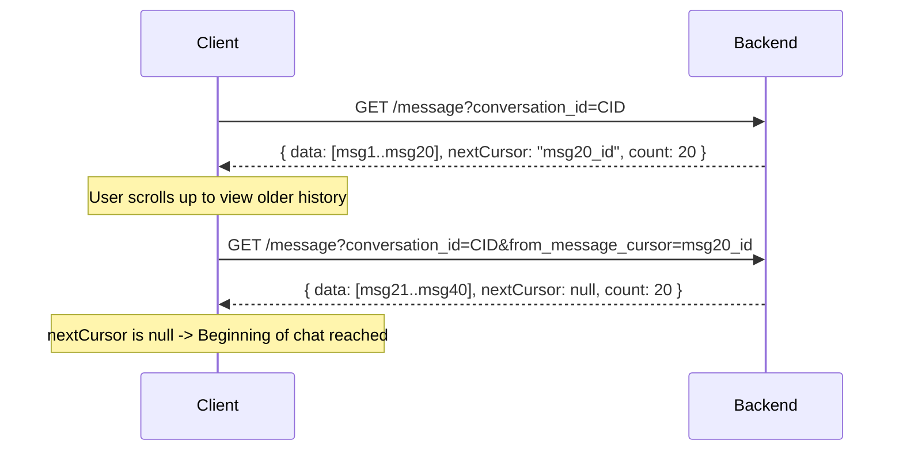

# In-Class Chat Application (`ChatApp`)

A complete **React Native + Expo Mobile Messenger (`frontend/`)** and **NestJS + Prisma + MongoDB Backend (`backend/`)** interfacing with the classroom server (`http://10.7.1.51:3000`), local Docker (`http://localhost:3000`), or the built-in Offline Mock Engine.

---

## Project Structure (`inClass/ChatApp/`)

```text
inClass/ChatApp/
├── README.md          # Complete project & API documentation (this file)
├── buildPlan.md       # Full architectural analysis & 9-screen UI wireframes
├── decisions.md       # Critical engineering decisions & backend discoveries log
├── backend/           # Cloned NestJS + Prisma + MongoDB backend (rt-nst-ru/MobileApp-Bakcend-5thSem)
└── frontend/          # Expo + React Native Mobile Application (Expo Router + TypeScript)
```

### Running the Mobile App (`frontend/`)

```bash
cd inClass/ChatApp/frontend
npm install
npx expo start
```

* Press **`w`** to open in Web browser, **`i`** for iOS Simulator, **`a`** for Android Emulator, or scan the QR code with **Expo Go**.
* On the Login screen (`app/login.tsx`), you can connect directly to the **Lab Server (`http://10.7.1.51:3000`)**, **Local Docker (`http://localhost:3000`)**, or switch to the **Offline Mock Engine** when working outside the classroom network.

---

## Architecture Overview



---

## Critical Authentication Architecture

> [!CAUTION]
> ### Plaintext Basic Auth Quirk
> Standard HTTP Basic Auth expects Base64-encoded credentials (`Authorization: Basic <base64>`).
> However, this backend server explicitly parses the raw header string in plain text:
> 
> ```http
> Authorization: Basic <username>:<password>
> ```
> 
> Standard HTTP clients (`curl -u`, Axios `auth` config, or Postman's built-in "Basic Auth" tab) that automatically base64-encode credentials will be rejected with:
> `401 Unauthorized: Invalid Basic auth format. Expected: Basic <username>:<password>`.
> 
> Always set the raw header string manually.

### Zero-Registration User Auto-Provisioning
There is no separate `/auth/register` endpoint. Supplying a valid plaintext `Basic <username>:<password>` header automatically provisions the user record in MongoDB if it does not already exist.

* **Registered Student Account:** `aryan.vibhuti2024@nst.rishihood.edu.in`
* **Student User ID (`ObjectId`):** `6ae190ee596b5b3b79cac735`
* **Default Display Name:** `aryan.vibhuti2024@nst.rishihood.edu.in`

---

## API Specifications & Endpoints

Base URL: `http://10.7.1.51:3000`  
Interactive Swagger Docs: `http://10.7.1.51:3000/docs`  
Raw OpenAPI Spec: `http://10.7.1.51:3000/docs-json`

### 1. User Management

| Method | Endpoint | Description | Query Parameters |
| :--- | :--- | :--- | :--- |
| `GET` | `/user/profile` | Fetches user profile. Defaults to caller if `user_id` is omitted. | `user_id` (optional, 24-char ObjectId) |
| `GET` | `/user` | Lists all registered users on the server for discovery. | *None* |

#### User Model (`UserResponseDto`)
```json
{
  "id": "6ae190ee596b5b3b79cac735",
  "name": "aryan.vibhuti2024@nst.rishihood.edu.in",
  "bio": null
}
```

---

### 2. Conversations

| Method | Endpoint | Description | Request Body |
| :--- | :--- | :--- | :--- |
| `GET` | `/conversation` | Retrieves all conversations the caller belongs to, newest first. | *None* |
| `POST` | `/conversation` | Initiates a DM or Group conversation. Idempotent for DMs. | `CreateConversationDto` |

#### Creating a Conversation (`CreateConversationDto`)

**Direct Message (DM):**
```json
{
  "type": "DM",
  "recipient_id": "6ae191ea596b5b3b79cac73e"
}
```
*Note: For DMs, if a thread with the specified recipient already exists, the server returns the existing record instead of creating a duplicate.*

**Group Chat:**
```json
{
  "type": "GROUP",
  "name": "Team Study Group",
  "participants_ids": [
    "6ae191ea596b5b3b79cac73e",
    "6ae190cf596b5b3b79cac734"
  ]
}
```
*(The authenticated caller is automatically added to `participants_ids`).*

---

### 3. Messages & Pagination

| Method | Endpoint | Description | Parameters / Payload |
| :--- | :--- | :--- | :--- |
| `GET` | `/message` | Retrieves paginated messages using reverse cursors. | `conversation_id` (required)<br>`from_message_cursor` (optional) |
| `POST` | `/message` | Dispatches a new text message. | `CreateMessageDto` |

#### Sending a Message (`CreateMessageDto`)
```json
{
  "conversation_id": "6ae1927c596b5b3b79cac745",
  "content": "Hello Sir"
}
```

#### Message Model (`MessageResponseDto`)
```json
{
  "id": "6ae19286596b5b3b79cac746",
  "content": "Hello Sir",
  "createdAt": "2026-10-28T06:13:26.925Z",
  "senderId": "6ae190ee596b5b3b79cac735",
  "conversationId": "6ae1927c596b5b3b79cac745",
  "status": {
    "6ae190ee596b5b3b79cac735": { "delivered": true, "read": true },
    "6ae191ea596b5b3b79cac73e": { "delivered": false, "read": false }
  }
}
```

#### Cursor-Based Pagination Workflow


---

## Step-by-Step Guide: Sending Messages via cURL

Follow this 4-step sequence in your terminal to complete the full message lifecycle.

### Step 1: Set Up Terminal Session Variables
```bash
export CHAT_SERVER="http://10.7.1.51:3000"
export CHAT_AUTH="Authorization: Basic aryan.vibhuti2024@nst.rishihood.edu.in:Aryan@1122334455"
```

### Step 2: Discover Users & Locate Recipient ID
Fetch all registered users to obtain the target recipient's 24-character MongoDB `id`:
```bash
curl -s -H "$CHAT_AUTH" "$CHAT_SERVER/user"
```
*Example response snippet:*
```json
[
  { "id": "6ae191ea596b5b3b79cac73e", "name": "Ritesh", "bio": null },
  { "id": "6ae190cf596b5b3b79cac734", "name": "abhinay", "bio": null }
]
```
*(Copy the recipient's `id`, e.g., `6ae191ea596b5b3b79cac73e`).*

### Step 3: Create or Retrieve the DM Conversation Thread
Initiate a Direct Message conversation with the recipient. If one already exists, the server returns the existing thread:
```bash
curl -s -X POST \
  -H "$CHAT_AUTH" \
  -H "Content-Type: application/json" \
  -d '{"type":"DM","recipient_id":"6ae191ea596b5b3b79cac73e"}' \
  "$CHAT_SERVER/conversation"
```
*Response:*
```json
{
  "id": "6ae1927c596b5b3b79cac745",
  "name": null,
  "type": "DM",
  "createdAt": "2026-10-28T06:13:16.740Z",
  "createdBy": "6ae190ee596b5b3b79cac735",
  "participants_ids": [
    "6ae190ee596b5b3b79cac735",
    "6ae191ea596b5b3b79cac73e"
  ]
}
```
*(Copy the conversation `id`, e.g., `6ae1927c596b5b3b79cac745`).*

### Step 4: Dispatch the Message
Post the text payload referencing the conversation `id`:
```bash
curl -s -X POST \
  -H "$CHAT_AUTH" \
  -H "Content-Type: application/json" \
  -d '{"conversation_id":"6ae1927c596b5b3b79cac745","content":"Hello Sir"}' \
  "$CHAT_SERVER/message"
```
*Response:*
```json
{
  "id": "6ae19286596b5b3b79cac746",
  "content": "Hello Sir",
  "createdAt": "2026-10-28T06:13:26.925Z",
  "senderId": "6ae190ee596b5b3b79cac735",
  "conversationId": "6ae1927c596b5b3b79cac745",
  "status": {
    "6ae190ee596b5b3b79cac735": { "delivered": true, "read": true },
    "6ae191ea596b5b3b79cac73e": { "delivered": false, "read": false }
  }
}
```

### Step 5: Verify the Conversation Thread History
Fetch the conversation history to confirm delivery:
```bash
curl -s -H "$CHAT_AUTH" "$CHAT_SERVER/message?conversation_id=6ae1927c596b5b3b79cac745"
```

---

## Step-by-Step Guide: Sending Messages via Postman

> [!WARNING]
> ### Crucial Postman Configuration Warning
> **DO NOT** use the `Authorization` tab with type `Basic Auth` in Postman!  
> Postman's built-in Basic Auth automatically Base64-encodes the credentials into `Authorization: Basic <base64>`, which will trigger a `401 Unauthorized` response from this server.
>
> **The Fix:**
> 1. Set the **Authorization** tab to **No Auth** (or *Inherit auth from parent*).
> 2. Manually add the unencoded authorization header under the **Headers** tab.

---

### Request 1: Discover Users (`GET /user`)

1. Open Postman and click **+** to open a new request tab.
2. Set the HTTP Method to **`GET`**.
3. Enter the Request URL:
   ```
   http://10.7.1.51:3000/user
   ```
4. Navigate to the **Headers** tab and add the following two key-value pairs:
   | Key | Value |
   | :--- | :--- |
   | `Authorization` | `Basic aryan.vibhuti2024@nst.rishihood.edu.in:Aryan@1122334455` |
   | `Content-Type` | `application/json` |
5. Click **Send**.
6. In the response panel below, locate your recipient (e.g. `"name": "Ritesh"`) and copy their `"id"`:
   ```json
   "6ae191ea596b5b3b79cac73e"
   ```

---

### Request 2: Create or Get Conversation (`POST /conversation`)

1. Open a new request tab in Postman.
2. Set the HTTP Method to **`POST`**.
3. Enter the Request URL:
   ```
   http://10.7.1.51:3000/conversation
   ```
4. Navigate to the **Headers** tab and ensure the headers are present:
   | Key | Value |
   | :--- | :--- |
   | `Authorization` | `Basic aryan.vibhuti2024@nst.rishihood.edu.in:Aryan@1122334455` |
   | `Content-Type` | `application/json` |
5. Navigate to the **Body** tab:
   - Select the **raw** radio button.
   - Choose **JSON** from the format dropdown (far right).
   - Paste the following payload:
     ```json
     {
       "type": "DM",
       "recipient_id": "6ae191ea596b5b3b79cac73e"
     }
     ```
6. Click **Send**.
7. The status will return `201 Created` (or `200 OK` if the thread already exists). Copy the returned `"id"`:
   ```json
   "6ae1927c596b5b3b79cac745"
   ```

---

### Request 3: Dispatch Message (`POST /message`)

1. Open a new request tab in Postman.
2. Set the HTTP Method to **`POST`**.
3. Enter the Request URL:
   ```
   http://10.7.1.51:3000/message
   ```
4. Navigate to the **Headers** tab and add:
   | Key | Value |
   | :--- | :--- |
   | `Authorization` | `Basic aryan.vibhuti2024@nst.rishihood.edu.in:Aryan@1122334455` |
   | `Content-Type` | `application/json` |
5. Navigate to the **Body** tab:
   - Select **raw** -> **JSON**.
   - Paste the payload containing the conversation ID and your message text:
     ```json
     {
       "conversation_id": "6ae1927c596b5b3b79cac745",
       "content": "Hello Sir"
     }
     ```
6. Click **Send**.
7. Status returns `201 Created`. The message is delivered with status flags:
   ```json
   {
     "id": "6ae19286596b5b3b79cac746",
     "content": "Hello Sir",
     "createdAt": "2026-10-28T06:13:26.925Z",
     "senderId": "6ae190ee596b5b3b79cac735",
     "conversationId": "6ae1927c596b5b3b79cac745",
     "status": {
       "6ae190ee596b5b3b79cac735": { "delivered": true, "read": true },
       "6ae191ea596b5b3b79cac73e": { "delivered": false, "read": false }
     }
   }
   ```

---

### Request 4: Read Conversation History (`GET /message`)

1. Open a new request tab in Postman.
2. Set the HTTP Method to **`GET`**.
3. Enter the Request URL:
   ```
   http://10.7.1.51:3000/message?conversation_id=6ae1927c596b5b3b79cac745
   ```
4. Under the **Headers** tab, add:
   | Key | Value |
   | :--- | :--- |
   | `Authorization` | `Basic aryan.vibhuti2024@nst.rishihood.edu.in:Aryan@1122334455` |
5. Click **Send**.
6. The response will display the paginated message list for this conversation thread.

---

### Pro-Tip: Fast-Import via Postman's "Import cURL" Feature

You can skip manually setting up each request in Postman:
1. In Postman, click the **Import** button (top-left).
2. Paste the exact cURL command directly into the text box:
   ```bash
   curl -X POST http://10.7.1.51:3000/message \
     -H "Authorization: Basic aryan.vibhuti2024@nst.rishihood.edu.in:Aryan@1122334455" \
     -H "Content-Type: application/json" \
     -d '{"conversation_id":"6ae1927c596b5b3b79cac745","content":"Hello Sir"}'
   ```
3. Postman will automatically configure the Method, URL, Headers, and raw JSON Body for you.
