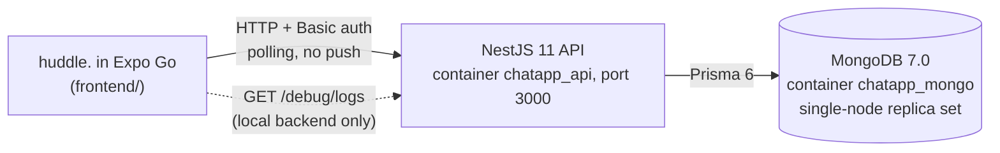

# ChatApp: huddle.

A mobile chat app built in class: an Expo React Native app called **huddle.** in `frontend/`, talking to the course instructor's NestJS chat server in `backend/`.

Compiled 2026-11-10. Facts are cited to file paths in this folder. Mermaid diagrams render on GitHub.

## Summary

huddle. is a chat app for phones. It does direct messages, group chats and photo messages, and it shows new messages in a notch island at the top of the screen. It runs in Expo Go (SDK 58) on Android or iOS, so nothing has to be built or installed on the phone except Expo Go itself. The server is the instructor's NestJS 11 backend, with Prisma 6 over MongoDB 7, and it runs on your Mac in Docker. A copy of the same backend runs on the instructor's class server, and the app can switch between the two from its login screen.

The project is also a teaching tool. Its built-in **Inspector** shows every request the app makes as it travels from the phone through the network to the NestJS server and into MongoDB. It explains each one twice, first as a plain sentence and then with the exact method, path, headers, payload, reply and timing. It was built for the class viva, so a reader can see the architecture working instead of taking it on trust.

The contract between the two halves is `swagger.json`, the instructor's API description. The app only uses the routes listed there. The local backend adds four things on top (read receipts, a log feed for the Inspector, cleanup of unsent uploads and demo data), and none of them changes a route or a response shape. That is why the same app works against both servers.

## How the parts fit



Source: `backend/docker-compose.yml`, `frontend/src/api/client.js`, `frontend/src/constants/config.js`.

Every request carries `Authorization: Basic <username>:<password>`, with the username and password in plain text and not base64-encoded. The server creates the user the first time it sees a new username (`backend/src/auth/auth.guard.ts`). The backend has no push channel, so the app polls instead. The open chat refreshes every 3 seconds and the chat list every 5. An inbox checker goes through every chat in turn, and one full round takes 10 seconds (`frontend/src/constants/config.js`, `POLL_MS`). The app finds your Mac's backend automatically from the address Expo Go connected to (`frontend/src/api/baseUrl.js`), so you never type an IP for the local server.

## Quick start

You need macOS with Docker Desktop and Node.js, and a phone with Expo Go on the same Wi-Fi as the Mac.

```bash
# Terminal 1: the server (from inClass/ChatApp/backend)
cp .env.example .env
npm run docker:up                      # MongoDB + API; leave it running

# Terminal 2: demo data, once (from anywhere)
docker exec chatapp_api npm run seed   # users aarav, diya, kabir, meera, rohan; password demo123

# Terminal 2: the app (from inClass/ChatApp/frontend)
npm install
npx expo start                         # scan the QR code with Expo Go
```

Expo Go asks you to sign in to an Expo account before it opens a project, so do that first. The first time the phone connects, macOS may ask whether Node or Docker can accept incoming connections. Allow it, or the phone cannot reach port 3000. Log in as `aarav` with password `demo123`.

You are done when `http://localhost:3000/docs` shows the Swagger page on the Mac and the app opens on the Chats screen with aarav's two direct messages (diya, kabir) and the "Study Group". To use the class server instead, choose **class server** on the login screen, type the address your teacher gives you (for example `http://10.7.1.51:3000`) and tap **test**.

## What is in each half

| Part | What it does | Where to read more |
|---|---|---|
| App screens | Login (local or class server), Chats with a groups carousel and unread badges, a chat with text and photos, People with search and New group, Profile with avatar style, appearance and the Inspector | `frontend/app/`, [`frontend/README.md`](frontend/README.md) |
| Notch island | A pill around the front camera that shows new messages with quick reply, reconnecting, uploads, failed sends and confirmations, with tap, hold and swipe actions | `frontend/src/island/`, `frontend/src/components/island/` |
| Inspector | Five tabs (overview, flow, network, logs, tools) that show every request from the app to the server and the database | `frontend/src/debug/`, `frontend/src/components/inspector/` |
| API | Users, conversations, messages and files, with cursor pagination and auth on every route | `backend/src/{user,conversation,message,file,auth}/`, [`swagger.json`](swagger.json) |
| Data | Four Prisma models: `User`, `Conversation`, `Message`, `File` | `backend/prisma/schema.prisma` |
| Server extras | Read receipts, the log feed, upload cleanup, FactBot simulation, demo seed | `backend/src/{common,debug,bot}/`, `backend/prisma/seed.ts` |

Source: `frontend/app/`, `frontend/src/`, `backend/src/`, `backend/prisma/schema.prisma`.

## The API in one table

| Method | Path | What it does |
|---|---|---|
| `GET` | `/user` | Every registered user |
| `GET` | `/user/profile` | One user's profile; your own without `user_id` |
| `POST` | `/conversation` | Create a DM or group; returns the existing DM if there already is one |
| `GET` | `/conversation` | Your conversations |
| `POST` | `/message` | Send text, an attachment (`file_id`) or both |
| `GET` | `/message` | A conversation's history, page by page |
| `POST` | `/file` | Upload base64 (up to 10 MB); returns the `id` to send as `file_id` |
| `GET` | `/file/{id}` | A file's metadata and base64 contents |
| `GET` | `/file/{id}/download` | The raw bytes |
| `GET` | `/debug/logs` | Local only: recent server log lines for the Inspector (not in `swagger.json`) |

Source: `swagger.json` (`paths`), `backend/src/debug/debug.controller.ts`. Full request and response shapes are at `http://localhost:3000/docs` while the server runs.

## Local backend versus the class server

The backend in `backend/` started as the instructor's code, synced to the class `swagger.json` (commit 05aeac6, 2026-11-10). The additions below were made here, and each one keeps every route and response the same. `backend/README.md` describes them in full.

| Addition | Effect | Setting |
|---|---|---|
| Read receipts | Fetching conversations marks your messages delivered; opening a chat marks its messages read | always on |
| Server log feed | `GET /debug/logs` serves the last 500 log lines so the Inspector can show what the server did | `DEBUG_LOGS=true` (default in Docker) |
| Upload cleanup | Files uploaded but never sent in a message are deleted | `FILE_ORPHAN_TTL_HOURS=24` |
| Demo data | Five users, three DMs and a group with an image | `npm run seed` |
| Request logging | One readable line per request in `docker logs -f chatapp_api`, passwords never printed | always on |

Source: `backend/.env.example`, `backend/docker-compose.yml`, `git log -- backend`.

On the class server none of these exist. The app still works there, and the Inspector says "server logs unavailable here". It also labels the backend and database steps "from the code", because it is describing this repository's backend code rather than live server output.

## Folder layout

```
ChatApp/
  README.md          this file
  swagger.json       the instructor's API contract (OpenAPI)
  graphify.sh        rebuilds a code graph of both halves into graphify-out/ (ignored by git)
  backend/           NestJS + Prisma + MongoDB, run with Docker Compose
    src/             one module per resource, plus auth, bot, debug and common (logging)
    prisma/          schema.prisma and seed.ts
  frontend/          Expo app (huddle.)
    app/             screens, one file per route (Expo Router)
    src/             api, store, hooks, inbox, island, debug, components, utils
    buildPlan.md     the plan: screens, flows, build order, decisions
    design.md        the design system: colour, type, motion
```

## Documentation and further reading

1. [`frontend/README.md`](frontend/README.md): running the app, its scripts, the code rules, the island gestures, the Inspector tabs and a phone checklist.
2. [`backend/README.md`](backend/README.md): running the server with and without Docker, environment settings, logging and the local additions.
3. [`frontend/buildPlan.md`](frontend/buildPlan.md): how the app was planned and built, section by section.
4. [`frontend/design.md`](frontend/design.md): the "soft slab" design system.
5. [`swagger.json`](swagger.json): the API contract; open it in any OpenAPI viewer, or see it live at `/docs`.

## When something goes wrong

If the app says it cannot reach the server, the phone and the Mac are usually on different networks, or the macOS firewall blocked port 3000. Check `curl http://localhost:3000/user -H 'Authorization: Basic aarav:demo123'` on the Mac first: if that answers, the problem is between phone and Mac. If `npm run docker:up` fails because port 3000 or 27017 is taken, stop whatever holds it (Athena's backend in `inClass/Proctor` also uses port 3000). `npm run docker:down`, `docker:logs` and `docker:up:bot` call the older `docker-compose` command, while `docker:up` calls `docker compose`. If your Docker install only has the newer one, run `docker compose down` and `docker compose logs -f api` directly.

## Caveats

The server is open by design. It is meant for about 200 students on one classroom network. Passwords travel in plain text over HTTP and any new username creates an account, so do not reuse a real password. Unread counts are kept on the phone, because the instructor's API has no per-user read state. The 10-second message delay comes from polling and is not a bug. The Expo Go sign-in requirement comes from Expo's announcements rather than a test on every device. The project has been checked on phones through Expo Go only. No standalone build (APK or IPA) has been made or tested, because sharing a release was dropped for now (`frontend/buildPlan.md`, section 16).
