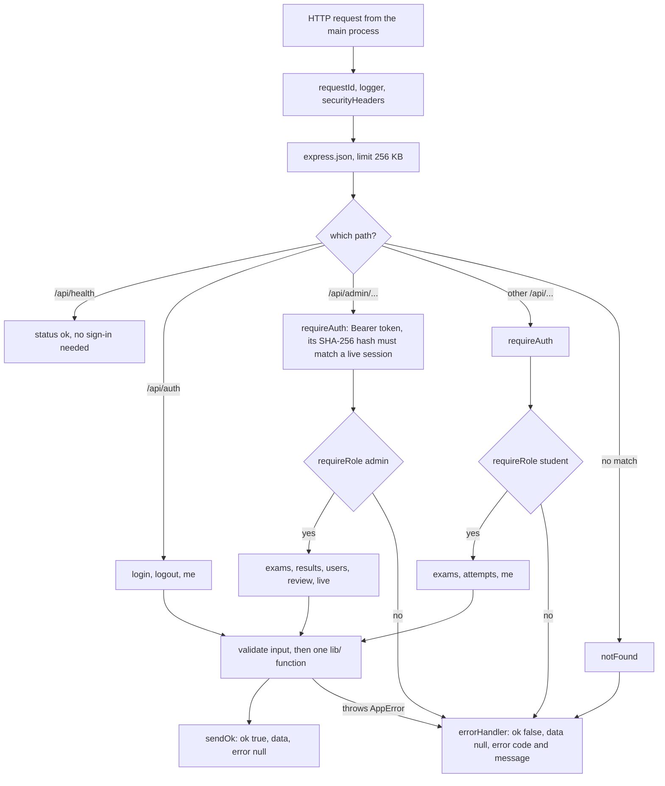
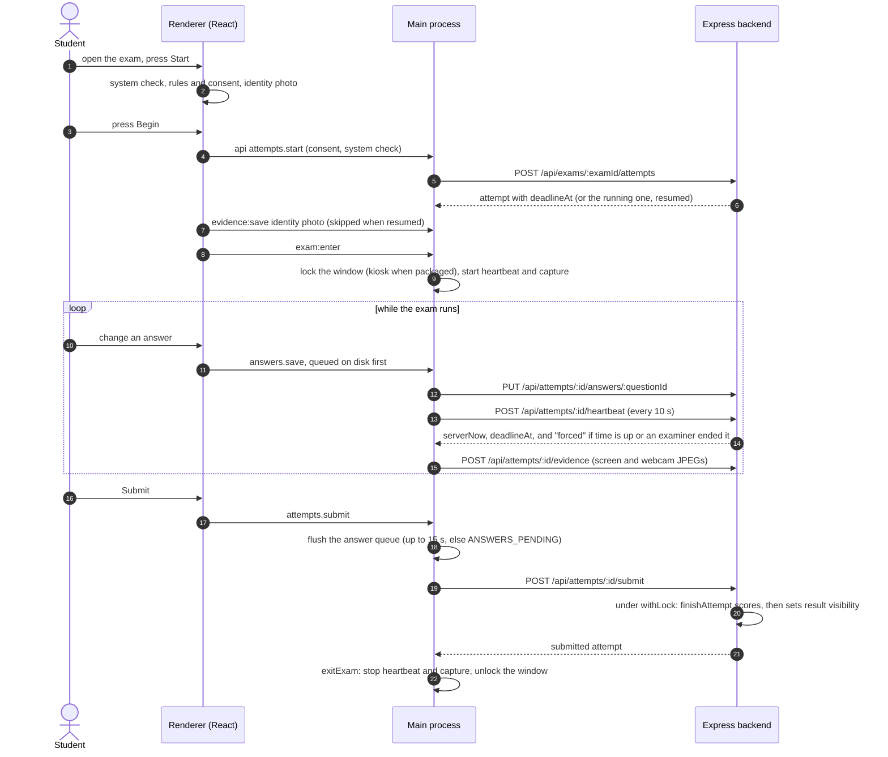
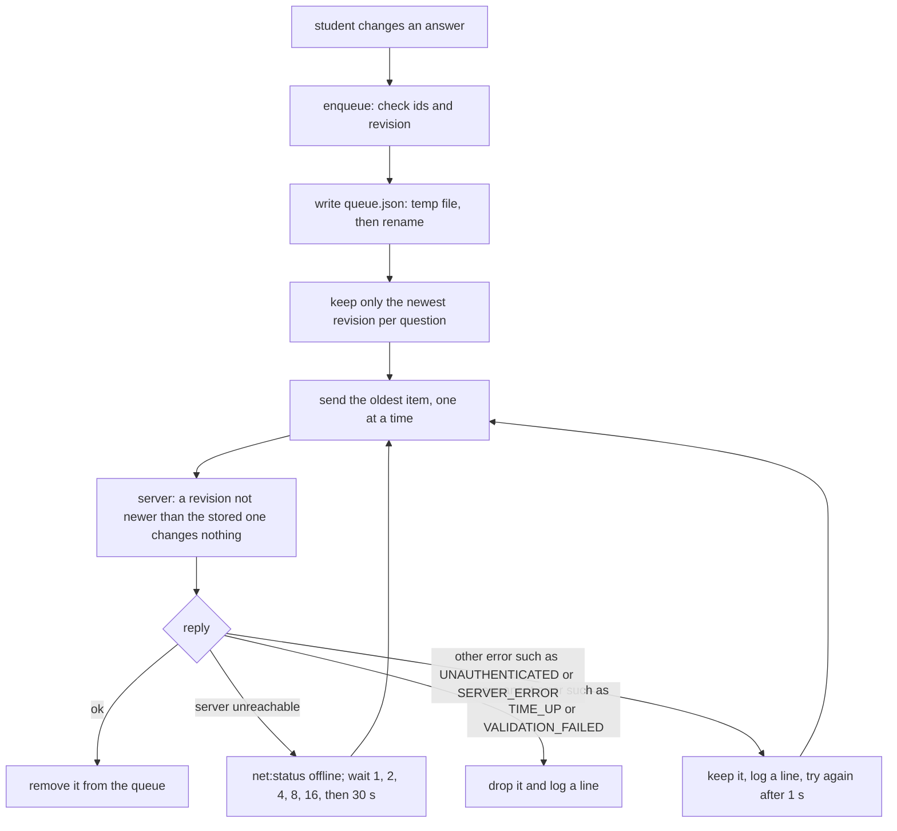
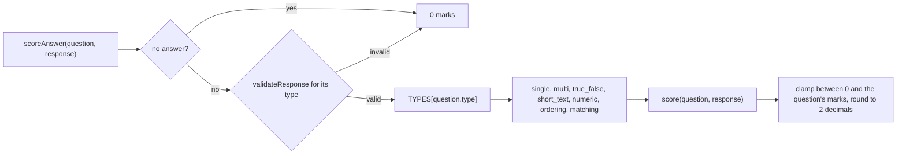

# Athena

A desktop exam app for a classroom: examiners build and run timed exams, students take them on a Mac, and every exam leaves a record of screen and webcam screenshots.

Compiled 2026-10-25, updated 2026-11-10. Facts are cited to file paths in this folder; the detailed documents in `docs/` cite the code they describe. The folder is called `Proctor` because the assignment was a proctored exam app; the app itself is named Athena (`app/package.json`, `productName`).

## Summary

Athena is an Electron 44 desktop app (React 19 UI, built with Vite 8) talking to a small Express 5 server that keeps its data in JSON files. One app serves two roles. An examiner signs in to write questions in seven auto-graded formats, publish an exam with a time window, watch who is writing, and publish results. A student signs in, passes a short system check, agrees to the capture terms, takes an identity photo and writes the exam in a locked window. While the exam runs, Athena saves a screenshot of its own window and a webcam photo about once a minute into `backend/screenshots/`, sorted by candidate and test, so the examiner can review them afterwards.

Earlier versions tried automated proctoring (face detection, focus and fullscreen flags, risk scores). It was removed on 2026-10-25 because it was not reliable enough to ship, and screenshots took its place. `docs/ARCHITECTURE.md` explains that decision. On 2026-11-03 every screen, admin and student, was restyled to one design system, "calm editorial", written down in `app/DESIGN.md` (commit f3f103c, 81 files). That pass changed how the screens look and added two shared components (`PageHeader`, `Segmented`), without adding routes or API calls. It made one behaviour change: during an exam the packaged app now uses macOS kiosk mode (Dock and menu bar hidden, app switching and Force Quit off), while a development run still only goes fullscreen so DevTools stay usable (`app/electron/exam.js`, `lockWindow`).

## Architecture

The animated figure shows the whole app and the path of an answer, a heartbeat and a screenshot: dots travel the real paths. It follows GitHub's light or dark theme and stands still if your system asks for reduced motion. The diagrams after it each open one mechanism step by step. Every box names the file it comes from.

<picture>
  <source media="(prefers-color-scheme: dark)" srcset="docs/diagrams/process-model-dark.svg">
  
</picture>

Source: `app/electron/window.js`, `preload.cjs`, `validate.js`, `api.js`, `routes.js`, `session.js`, `queue.js`, `heartbeat.js`, `capture.js`, `evidence.js`, `exam.js`; `backend/server.js`, `backend/lib/`.

The design rests on one rule: the page never talks to the network. The renderer is an ordinary React app running with `contextIsolation`, `sandbox` and no `nodeIntegration`, so it has no Node.js and cannot call `fetch` against the server itself. It can only call the functions the preload script exposes on `window.athena`. Each of those invokes exactly one IPC channel, and the main process checks that every call comes from Athena's own page before it does anything. All HTTP goes through `api.js` in the main process. It knows 51 named routes, refuses the 8 marked internal when the page asks for them, and adds the Bearer token, which never enters the page.

The main process also makes the app survive a bad network. An answer is written to `queue.json` before it is sent, and screenshots are written to `pending-uploads/` with a manifest before they are uploaded, so a crash or a dropped Wi-Fi loses nothing. The heartbeat keeps the countdown honest: the server's clock decides when time is up. On the server, a fixed middleware order and an `{ ok, data, error }` envelope give every route the same shape. The rules live in small `lib/` modules, and the data lives in four JSON files that are always written to a temporary file and renamed, so a half-written file can never replace a good one.

### System design concepts used

| Concept | Where it shows | Code |
|---|---|---|
| Process isolation and least privilege | The page has no Node.js and no network; only main reaches the network and the file system | `app/electron/window.js` |
| Allow-listed IPC bridge | `window.athena` exposes fixed functions, one channel each; events only from a fixed list | `app/electron/preload.cjs` |
| Sender validation | Every IPC handler rejects calls from any frame that is not Athena's UI | `app/electron/validate.js` (`handle`, `isTrustedSender`) |
| Token custody | The Bearer token stays in main, on disk only encrypted with `safeStorage` | `app/electron/session.js` |
| Custom protocol | The packaged UI loads from `app://athena`, not from `file://` | `app/electron/protocol.js` |
| Durable queue, at-least-once delivery | Answers are saved to disk first and sent one at a time; when the server is unreachable they wait 1, 2, 4, 8, 16, then 30 s | `app/electron/queue.js` |
| Idempotent writes | An answer revision that is not newer than the stored one changes nothing, so retries are safe; screenshot uploads dedupe on kind and sequence | `backend/lib/attempts.js`, `backend/lib/evidence.js` |
| Heartbeat and server time | Every 10 s; the countdown uses the median of 5 clock offsets; the server can end the attempt | `app/electron/heartbeat.js`, `backend/lib/finalize.js` |
| Atomic file writes | Write `name.json.tmp`, then rename over `name.json` | `backend/lib/store.js` |
| Per-key locking | `withLock` serialises work on one attempt, so a heartbeat and an answer cannot interleave | `backend/lib/locks.js` |
| Lazy expiry | An overdue attempt is closed the next time it is read; no background job | `backend/lib/finalize.js` (`closeIfOverdue`) |
| Role-based access control | `requireAuth` then `requireRole('admin')` or `requireRole('student')` per router | `backend/server.js`, `backend/lib/auth.js` |
| Password and token storage | scrypt with a 16-byte salt; tokens kept only as SHA-256 hashes | `backend/lib/auth.js` |
| Uniform response envelope | Every reply is `{ ok, data, error }`, local IPC errors use the same shape | `backend/lib/http.js`, `app/electron/validate.js` |
| Strategy pattern | One scoring module per question type behind one interface | `backend/lib/scoring/index.js` |

<details>
<summary><b>How the server handles a request</b></summary>



Source: `backend/server.js` (`createApp`), `backend/lib/http.js` (`sendOk`, `errorHandler`), `backend/lib/auth.js` (`requireAuth`, `requireRole`).

A missing or unknown token answers `UNAUTHENTICATED`, and a wrong role answers `FORBIDDEN`. Both come back in the same envelope as a success, so the app handles every outcome in one place.

</details>

<details>
<summary><b>One exam attempt, from system check to submit</b></summary>



Source: `app/src/features/pretest/` (`SystemCheckPage`, `RulesPage`, `PhotoPage`, `BeginPage`), `app/electron/exam.js`, `app/electron/api.js` (`submit`), `app/electron/heartbeat.js`, `backend/routes/exams.js`, `backend/routes/attempts.js`, `backend/lib/attempts.js`, `backend/lib/finalize.js`.

The submit request is sent first and the exam is closed after it returns (`api.js`, `submit`). If the queue cannot empty within 15 seconds, the app refuses to submit rather than lose answers. Screenshot uploads keep going after submit until their manifest is empty, and the server accepts them for that reason.

</details>

<details>
<summary><b>Why a lost connection does not lose an answer</b></summary>



Source: `app/electron/queue.js` (`BACKOFF_SECONDS`, `PERMANENT_CODES`, `drain`), `backend/lib/attempts.js` (revision check), `backend/lib/constants.js` (`ANSWER_GRACE_MS`).

The queue gives at-least-once delivery: an answer can arrive twice but never zero times. The server makes the second arrival harmless by comparing revisions. Answers are accepted for 30 seconds after the deadline, to cover requests already in flight.

</details>

<details>
<summary><b>How an answer is scored</b></summary>



Source: `backend/lib/scoring/index.js` (`TYPES`, `scoreAnswer`, `round2`), one file per type in `backend/lib/scoring/`.

Every type module has the same parts (`parseDefinition`, `keyProblems`, `validateResponse`, `score`, `studentConfig`, `label` and a `shuffle` rule), so adding a question type means adding one file and one line to `TYPES`.

</details>

## Quick start

You need macOS on Apple Silicon, Node.js 22 or newer and a camera. From this folder:

```bash
./start.sh
```

The script installs dependencies and seeds the database on the first run, then starts the backend on port 3000, the UI server on port 5173 and the Athena window. It is safe to run again: anything already running is left alone (`start.sh`). Sign-in details for the seeded admin and ten students are written to `backend/data/seed-credentials.txt`. Stop everything with `./stop.sh`. Logs go to `.run/backend.log`, `.run/vite.log` and `.run/electron.log`.

You are done when the Athena window shows the sign-in screen and `curl http://127.0.0.1:3000/api/health` returns `"status":"ok"`. If port 3000 is taken by another program, the script names it and stops; the ChatApp backend in `../ChatApp` also uses port 3000, so stop it first (`docker stop chatapp_api`). `docs/OPERATIONS.md` covers that and other problems.

## Where the screenshots go

Every image lands in one folder, grouped by candidate, then test, then source:

```
backend/screenshots/
  Dev_Khanna/                                            candidate
    Viva_Demo_Exam/                                      test
      webcam/Dev_Khanna-Viva_Demo_Exam-2026-10-25_22-21-29.jpg   identity photo
      webcam/Dev_Khanna-Viva_Demo_Exam-2026-10-25_22-21-32.jpg   webcam photo
      screen/Dev_Khanna-Viva_Demo_Exam-2026-10-25_22-21-32.jpg   screenshot of the Athena window
```

The first pair is taken 3 seconds after the exam opens and then one pair every 45 to 60 seconds, a range the examiner can change per exam (`app/electron/capture.js`). File names are `<Candidate>-<Test>-<date_time>.jpg` in the server's local time, and a second image in the same second gets `_2` instead of overwriting the first (`backend/lib/evidence.js`, `backend/lib/attemptFiles.js`). The folder is gitignored and `npm run seed` never deletes it. `docs/DATA_AND_STORAGE.md` has the full rules.

## What is in the box

| Area | What works | Code |
|---|---|---|
| Student | Exams list and exam details, system check, rules and consent, identity photo, exam room with autosave and offline queue, review and submit, receipt PDF, results, personal analytics | `app/src/features/{student,pretest,exam,results}` |
| Exam lock | Fullscreen in development, kiosk mode in the packaged app, a heartbeat, and confirm dialogs before submit and quit | `app/electron/exam.js` |
| Examiner | Home, exams (create, duplicate, delete, publish), an exam workspace with tabs for questions (builder for 7 types), settings, live view (extend, end), review console with screenshot gallery, results (publish, CSV export) and analytics; students (add, reset password, turn off, CSV import) | `app/src/features/admin` |
| Both | Sign-in, choosing the server address, app settings (appearance, server, screenshots), a self-test page | `app/src/features/{auth,settings,selftest,shell}` |
| Desktop shell | Every HTTP call made by the main process, token kept out of the page, preload allow-list, screenshot timer, upload queue | `app/electron` |
| Server | Auth, exams, attempts, scoring (one file per question type), results, analytics, image storage | `backend/routes`, `backend/lib` |

Source: `app/src/routes.jsx`, `app/electron/routes.js`, `backend/server.js`.

## Scripts

| Folder | Command | What it does |
|---|---|---|
| this folder | `./start.sh`, `./stop.sh` | Start or stop backend, UI server and app window |
| `backend/` | `npm start` | API on `http://127.0.0.1:3000` |
| `backend/` | `npm run seed` | Resets `data/` (never `screenshots/`): 1 admin, 10 students, 4 open exams |
| `backend/` | `npm run smoke` | The whole exam story over HTTP on a temporary data folder; prints PASS or FAIL |
| `app/` | `npm run dev`, `npm run electron` | UI server and app window, one at a time |
| `app/` | `npm run lint` | ESLint |
| `app/` | `npm run selftest` | Loads the packaged UI, prints one JSON line, exits 0 only if it passes |
| `app/` | `npm run dist` | Builds the arm64 DMG into `app/release/` |

Source: `backend/package.json`, `app/package.json`, `docs/OPERATIONS.md`.

## Repository layout

```
Proctor/
  start.sh, stop.sh     start and stop backend, UI server and app
  app/                  Electron main process (electron/) and React UI (src/)
    DESIGN.md           the "calm editorial" design system every screen follows
  backend/              Express server, JSON data (data/), screenshots (screenshots/)
  docs/                 the documentation below; docs/diagrams/ holds the animated figure
  BUILD_PLAN.md         original build plan (written before proctoring was removed)
  SCREENS.md            original screen specs (same caveat)
```

## Documentation and further reading

Read them in this order if you are new to the project; the design alternatives that were considered and rejected are argued in `docs/ARCHITECTURE.md`.

1. [`docs/USER_GUIDE.md`](docs/USER_GUIDE.md): how an examiner and a student use the app, screen by screen.
2. [`docs/OPERATIONS.md`](docs/OPERATIONS.md): running, configuring, reseeding, building the DMG and fixing common problems.
3. [`docs/ARCHITECTURE.md`](docs/ARCHITECTURE.md): how the pieces fit, the decisions behind them and the alternatives that lost.
4. [`docs/DATA_AND_STORAGE.md`](docs/DATA_AND_STORAGE.md): every data file and the screenshots layout.
5. [`docs/API.md`](docs/API.md): the HTTP API, route by route.
6. [`docs/SECURITY.md`](docs/SECURITY.md): threat model, the controls in the code and the known gaps.
7. [`docs/TESTING.md`](docs/TESTING.md): what has been verified, how to re-run it and what has not been tested.
8. [`app/DESIGN.md`](app/DESIGN.md): colours, type, spacing and components of the design system.

## Caveats

`BUILD_PLAN.md` and `SCREENS.md` describe the plan as it stood before proctoring was removed, so their sections on flags, face detection and risk scores no longer match the app; the documents in `docs/` describe the code as it is. The documents in `docs/` were written on 2026-10-25, before the restyle, so any description of colours or layout in them is older than `app/DESIGN.md`, and where they say the exam goes fullscreen, the packaged app now uses kiosk mode instead; their account of screens, flows and rules is otherwise unchanged. Some proctoring-era code is still present: no client sends flag events any more, but `backend/lib/risk.js` still computes a risk score from heartbeat gaps and screenshot counts, which no screen shows, and the self-test page still exercises the old face detector (`app/src/proctoring/face.js`), which is why the app still copies MediaPipe files at build time. Two candidates with exactly the same name would share a screenshots folder, because folders are named by candidate name. The server speaks plain HTTP on the local machine and stores images unencrypted, which suits a classroom on one network and would need changing before wider use (`docs/SECURITY.md`).
