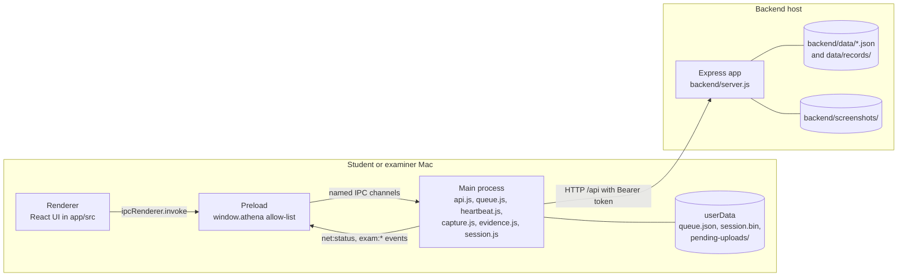
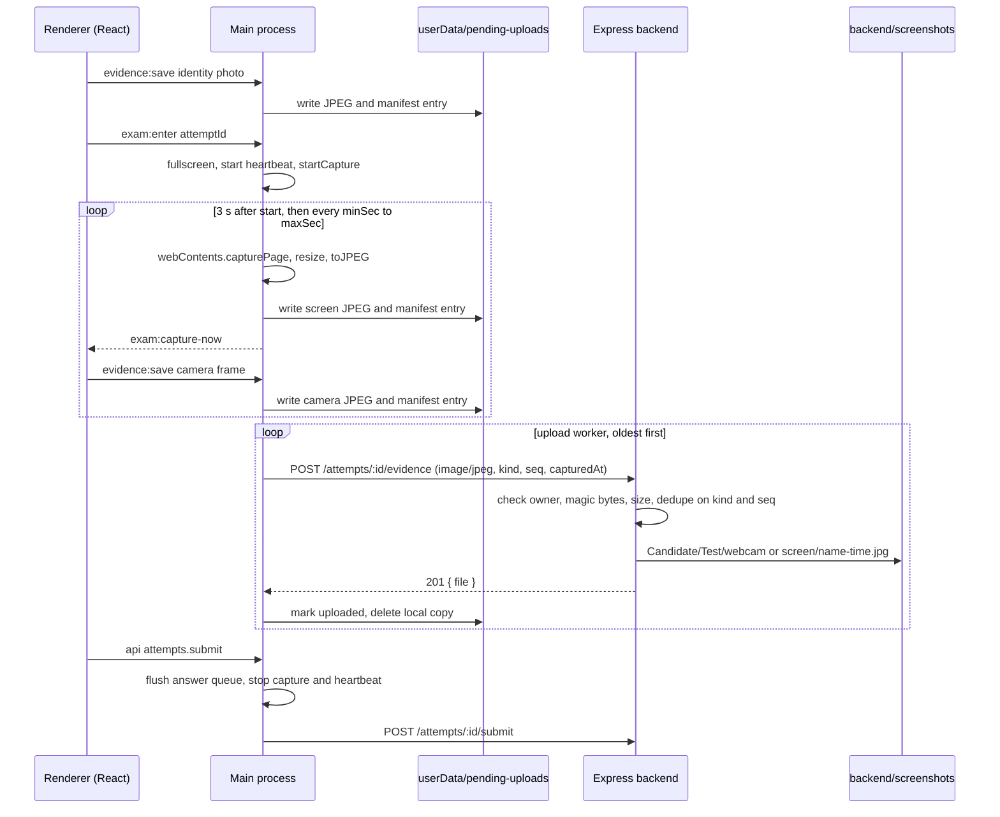

# Athena architecture: a locked-down Electron client, a small Express server and screenshots instead of proctoring

Compiled 2026-10-25. Claims about Athena are cited to file paths (and function names) in this repository; claims about Electron, Node.js and Express are cited to their official documentation. Diagrams use Mermaid, which renders on GitHub.

---

## Summary

Athena is a desktop exam system for one classroom. An Electron app (`app/`) runs on each Mac and serves both roles: examiners build exams, watch them live and publish results, and students take timed exams in fullscreen. A small Express server (`backend/`) holds every exam, attempt and answer in JSON files and is the only authority on time, scoring and who may see what.

The design rests on three decisions. First, the React page never talks to the network. It asks the Electron main process by name through a preload bridge (`window.athena`), and main makes every HTTP call and holds the login token (`app/electron/api.js`, `request()`). Second, nothing a student does is lost to a crash or a dropped connection: answers go into a durable queue on disk before they are sent (`app/electron/queue.js`), and images are staged on disk before they are uploaded (`app/electron/evidence.js`). Third, automated proctoring was removed on 2026-10-25. During an exam Athena now saves a screenshot of its own window and a webcam photo, 3 seconds after the exam opens and then every 45 to 60 seconds by default, and stores them on the server under `backend/screenshots/` for a person to review (`app/electron/capture.js`, `backend/lib/attemptFiles.js`).

The reader of this document is a grader or a teammate who needs to explain the system in a viva and run it. Setup steps are in the root `README.md`.

---

## Context and constraints: one Mac lab, one semester, class-taught Electron

Athena is a semester project, and the constraints shaped the design more than scale did. It targets macOS on Apple Silicon only (`app/package.json`, script `dist` builds `--mac dmg --arm64`) with Electron 44.7.0, React 19.3.0, Vite 8.3.4 and React Router 8.4.0 (`app/package.json`). The backend uses Express with no database and no third-party auth library (`backend/server.js`, `backend/lib/store.js`, `backend/lib/auth.js`).

The expected load is a class: tens of students, each sending a heartbeat every 10 seconds (`app/electron/heartbeat.js`, `INTERVAL_MS`), an answer on each change, and two JPEGs of at most 1 MB each per minute (`backend/lib/constants.js`, `LIMITS.EVIDENCE_BYTES`). No load test has been run, so there is no measured throughput figure. The server listens on `127.0.0.1:3000` by default, so out of the box only the same Mac can reach it (`backend/config.js`, `readHost`; `backend/server.js`, `start`). A lab deployment sets `HOST` to a LAN address.

`BUILD_PLAN.md` and `SCREENS.md` predate the removal of proctoring and are stale wherever they describe face detection, flags, risk scores or auto-ending.

---

## How it works: four layers and one rule about who talks to the network

### The process model puts all I/O in the main process

The renderer (`app/src/`) is an ordinary React app loaded from `app://athena/index.html` when packaged, or from the Vite dev server at `http://localhost:5173` in development (`app/electron/window.js`, `uiUrl`; `app/electron/protocol.js`, `handleAppScheme`). It runs with `contextIsolation: true`, `sandbox: true` and `nodeIntegration: false` (`app/electron/window.js`, `createMainWindow`), so it has no Node.js and no direct access to Electron.

The preload script (`app/electron/preload.cjs`) is the only bridge. It calls `contextBridge.exposeInMainWorld('athena', …)` with a fixed set of functions, each of which invokes exactly one IPC channel. `ipcRenderer` itself is never exposed, and event subscriptions accept only the channels listed in `EXAM_EVENTS` plus `theme:changed` and `net:status`. Electron's documentation describes this pattern as the way to give a sandboxed page limited, explicit capabilities ([Electron, Context Isolation](https://www.electronjs.org/docs/latest/tutorial/context-isolation)).

Every main-process handler is registered through one wrapper, `handle()` in `app/electron/validate.js`. It rejects calls from any frame that is not Athena's own UI (`isTrustedSender`) and returns the same `{ ok, data, error }` envelope the server uses, so the renderer treats local and remote failures the same way.

HTTP calls go through `request()`, `requestRaw()` and `requestFile()` in `app/electron/api.js`, which use Electron's `net.fetch` with a 10-second timeout (`REQUEST_TIMEOUT_MS`). The renderer can only name a route from the fixed table in `app/electron/routes.js` (`ROUTES`, 51 entries, 8 of them internal). Main fills path parameters only if they match `PATH_ID_PATTERN` or a per-parameter pattern, and refuses routes marked `internal` (login, heartbeat, evidence upload, CSV export, admin image download) when the renderer asks for them directly (`handleApiRequest`). The token is attached by main from `app/electron/session.js` and never crosses into the page.

Source: `app/electron/preload.cjs`, `app/electron/main.js` (`start`), `app/electron/api.js`, `backend/server.js` (`createApp`, `start`), `backend/lib/attemptFiles.js`.

### The backend is a pipeline of small modules over a JSON store

`backend/server.js` builds the Express app in a fixed order: request id, one log line per request, two hardening headers, a 256 KB JSON body parser, an unauthenticated `/api/health`, then three routers (`/api/auth`, `/api/admin` behind `requireAuth` and `requireRole('admin')`, and the student routes behind `requireRole('student')`), then the not-found and error handlers that produce the envelope (`backend/lib/http.js`).

Data lives in four JSON arrays (`users`, `sessions`, `exams`, `attempts`) under `backend/data/` (`backend/lib/store.js`, `FILES`). The store loads them once at startup, hands out deep-frozen copies, and writes through a per-file promise chain that writes `name.json.tmp` and renames it over the original, so a crash mid-write leaves the old file intact (`update`, `writeFileAtomic`). Per-attempt records (`captures.json`, `flags.json`, `events.jsonl`) live in `backend/data/records/<userId>/<attemptId>/` (`backend/lib/attemptFiles.js`, `attemptPath`). Read-modify-write sequences on one attempt are serialized by `withLock` in `backend/lib/locks.js`, so a heartbeat and an answer for the same attempt cannot interleave.

### Answers survive crashes through a durable queue

When a student changes an answer, the renderer calls `api('answers.save', …)`. Main does not send it straight away: `enqueue()` in `app/electron/api.js` validates the ids and the revision and hands it to `enqueueAnswer()` in `app/electron/queue.js`. The queue writes `userData/queue.json` (temp file plus rename) before anything is sent, keeps only the newest revision per question, and sends one request at a time. A network failure backs off 1, 2, 4, 8, 16 and then 30 seconds (`BACKOFF_SECONDS`) and broadcasts `net:status { online, queued }` so the UI can show an offline banner. Errors that will never succeed (`PERMANENT_CODES`, such as `TIME_UP` or `VALIDATION_FAILED`) drop the item with a log line. Others, such as `UNAUTHENTICATED` or `SERVER_ERROR`, keep it for a retry.

Submitting first calls `flush(15_000)` and refuses with `ANSWERS_PENDING` if the queue cannot empty in 15 seconds (`app/electron/api.js`, `submit`, `SUBMIT_FLUSH_MS`). The server, not the client, enforces the deadline: answers are accepted for 30 seconds after `deadlineAt` for requests already in flight (`backend/lib/constants.js`, `TIMING.ANSWER_GRACE_MS`), and an overdue attempt is finished lazily whenever it is next read, with no background job (`backend/lib/finalize.js`, `closeIfOverdue`).

### The heartbeat keeps the clock honest and carries server decisions back

While an exam runs, `app/electron/heartbeat.js` posts to `/attempts/:id/heartbeat` every 10 seconds with the window's fullscreen and focus state and the display count (`sensors`). The reply carries `serverNow` and `deadlineAt`. Main keeps the median of the last five clock offsets (`OFFSET_SAMPLES`), so one slow response cannot skew the countdown, and the renderer shows `deadlineAt - (Date.now() + offset)`. If the reply contains `forced` (deadline passed or an examiner ended the attempt), main calls `handleForced` in `app/electron/exam.js`, which stops capture and the heartbeat, leaves fullscreen and tells the renderer. On the server, silence longer than 30 seconds between heartbeats is recorded as a gap (`backend/lib/events.js`, `withHeartbeat`; `TIMING.HEARTBEAT_GAP_MS`), and the live view marks a student who has gone quiet (`TIMING.ATTENTION_SILENCE_MS`).

### Screenshots are taken by main, staged locally, then uploaded

`exam:enter` in `app/electron/exam.js` (`enterExam`) puts the window in fullscreen, starts the heartbeat and calls `startCapture()` in `app/electron/capture.js`. Capture schedules its first shot after 3 seconds (`FIRST_SHOT_MS`) and then picks a random delay between `minSec` and `maxSec` from the exam's `proctoring.screenshots` setting, falling back to 45 and 60 seconds (`DEFAULT_INTERVAL`, `intervalFrom`). Each shot calls `webContents.capturePage()` on Athena's own window, scales it to at most 1280 px wide and encodes JPEG at quality 70 (`takeScreenshot`). Capturing the app's own page does not need macOS Screen Recording permission, unlike capturing the desktop ([Electron, webContents](https://www.electronjs.org/docs/latest/api/web-contents)).

After each screenshot, main broadcasts `exam:capture-now`. The renderer hook `app/src/features/exam/useWebcamPhotos.js` grabs one frame from the camera stream started during the system check and sends it back through `evidence:save` with `kind: 'camera'`. The identity photo is taken before the exam on the photo step and saved with `kind: 'identity'` when the attempt starts (`app/src/features/pretest/BeginPage.jsx`); a resumed attempt does not repeat it.

All three kinds go through `saveImage()` in `app/electron/evidence.js`, which writes the JPEG to `userData/pending-uploads/<attemptCode>/<kind>/` and appends an entry to that attempt's `manifest.json` before anything is sent. The manifest is the upload queue. One worker uploads the oldest pending entry across all attempts as a raw `image/jpeg` body to `/attempts/:id/evidence`, marks it `uploaded: true` only after the server confirms, then deletes the local copy (`uploadOne`). Unreachable servers pause the worker with backoff of 5, 10, 20 and 30 seconds (`RETRY_MS`); permanent errors mark the entry `skipped` (`SKIP_CODES`). Uploads continue after submit until the manifest is empty, and the server accepts them after submit for that reason (`backend/lib/evidence.js`, `uploadEvidence`).

On the server, `uploadEvidence` checks the JPEG, is idempotent on `(kind, seq)` so a retried upload writes nothing, and saves the file under:

`backend/screenshots/<Candidate_Name>/<Test_Name>/{webcam,screen}/<Candidate_Name>-<Test_Name>-<YYYY-MM-DD_HH-mm-ss>.jpg`

Names are reduced to letters, digits and underscores and capped at 40 characters (`backend/lib/attemptFiles.js`, `namePart`). The timestamp is the client's `capturedAt` rendered in the server's local time (`backend/lib/evidence.js`, `localStamp`). A clash in the same second gets `_2`, `_3` and so on, up to 99 (`freeFileName`, `MAX_SAME_SECOND`). Both `camera` and `identity` land in `webcam/` (`IMAGE_FOLDER`). The server creates `backend/screenshots/` at startup (`backend/server.js`, `start`), and `EVIDENCE_DIR` can move it (`backend/config.js`, `readEvidenceDir`). Examiners view images in the review console through `evidence:adminImage`, which downloads one file via main and returns a data URL (`app/electron/files.js`, `adminImage`).

Source: `app/electron/exam.js` (`enterExam`, `exitExam`), `app/electron/capture.js`, `app/src/features/exam/useWebcamPhotos.js`, `app/src/features/pretest/BeginPage.jsx`, `app/electron/evidence.js` (`saveImage`, `uploadOne`), `app/electron/api.js` (`submit`), `backend/lib/evidence.js`, `backend/lib/attemptFiles.js`.

Capture runs for every exam regardless of its proctoring preset. `enterExam` always calls `startCapture`, and `useWebcamPhotos` is gated only on a running attempt, not on `proctoring.cameraPhotos` (`app/electron/exam.js`; `app/src/features/exam/useWebcamPhotos.js`). The exam's settings change only the interval.

### Result visibility is decided on the server

A student's score is returned only when `attempt.resultVisibleAt` is set (`backend/lib/attempts.js`, `getResult`, which otherwise answers `RESULTS_NOT_AVAILABLE`). `withVisibility()` in `backend/lib/visibility.js` sets it when the attempt is submitted and either the exam's policy is `after_submit` or the examiner has published results (`resultsPublishedAt`). `finishAttempt` applies the rule at the moment an attempt ends (`backend/lib/finalize.js`), and `syncExam` re-applies it to every attempt when results are published (`backend/lib/results.js`, `publishResults`). The student's attempt list returns null scores until the result is visible (`myAttemptList`). A "held" state for attempts auto-ended by the flag limit still exists in `isHeld`, but since nothing raises flags any more it no longer triggers.

### Proctoring-era code is still in the backend

The flag engine (`backend/lib/flags.js`), event ingestion (`backend/lib/events.js`, `ingest`), proctoring presets (`backend/lib/proctoring.js`) and risk score (`backend/lib/risk.js`) are still wired in. The client no longer reports proctoring events: `exam:event` in `app/electron/exam.js` still accepts types like `no_face`, but nothing in `app/src` calls it, and the heartbeat sends `events: []` (`app/electron/heartbeat.js`, `beat`). The only event main itself queues is `app_quit` when a student confirms quitting (`confirmQuit`), which the server records as information, not a flag (`backend/lib/constants.js`, `INFO_EVENTS`). So flag counts stay at zero and auto-end by flag limit cannot happen.

The risk score is not completely idle, though. `computeRisk` in `backend/lib/risk.js` still adds 5 points per heartbeat gap and 5 points when fewer than four in five of the expected screenshots arrived for an exam whose proctoring is enabled (`backend/lib/constants.js`, `RISK.PER_HEARTBEAT_GAP`, `RISK.LOW_COVERAGE`, `RISK.COVERAGE_MIN`; `coverageIsLow`). Both inputs still flow, so a student with a flaky network can show a non-zero risk level in the admin review queue. The admin UI also still offers the proctoring settings page (`admin.exams.updateProctoring` in `app/electron/routes.js`). `app/electron/detectors.js` is an empty placeholder, and the MediaPipe face-detection module (`app/src/proctoring/face.js`) and its build step (`app/scripts/copy-mediapipe.js`) are still in the client, used by the self-test page.

---

## Alternatives considered, and why each lost

**Renderer fetch versus main-process HTTP.** The renderer could call the server directly and keep the token in memory. It lost because the token is the student's identity for the whole exam, and keeping it in the page puts it in reach of any script that runs there. With main holding it in `app/electron/session.js`, an injected script can at most call the named routes the allow-list permits. A second, practical reason: the server address is set at runtime (`server:set`, validated by `serverUrl` in `app/electron/validate.js`), and a build-time CSP cannot list an address it does not know.

**desktopCapturer versus webContents.capturePage.** `desktopCapturer` would show whatever else is on screen, which is the stronger evidence for spotting a second app. It lost on cost and scope. On macOS it needs the Screen Recording permission, granted in System Settings and effective only after a relaunch; the app still carries the deep link for that pane (`app/electron/system.js`, `PRIVACY_URLS.screen`) from the proctoring era. Capturing only Athena's window needs no permission and collects nothing outside the exam. The tradeoff is real: a screenshot of Athena's own window cannot show another app. Fullscreen on entry (`enterExam`) narrows the gap but does not close it.

**SQLite versus JSON files.** SQLite would give transactions and indexed queries. It lost because the store's needs are small: four arrays, read from memory, written atomically, with per-attempt locks for read-modify-write (`backend/lib/store.js`, `backend/lib/locks.js`). The cost is that every write rewrites a whole file and every query is a linear scan; see the risks section.

**Keeping proctoring versus removing it.** Face detection with MediaPipe, focus and fullscreen flags, a risk score and auto-end were built (`app/src/proctoring/face.js`, `backend/lib/flags.js`, `backend/lib/risk.js`). They lost on 2026-10-25 because they were not reliable enough to ship before the submission deadline, and an unreliable auto-end punishes honest students. Screenshots plus a person reviewing them is slower but does not make automated accusations.

**Uploading versus local-only images.** Saving images only on the student's Mac would avoid sending faces over the network. It lost because review happens on the examiner's machine, and a student who controls the only copy can delete it. Athena keeps a local copy only until the server confirms receipt (`uploadOne` deletes it afterwards).

---

## Risks and failure modes

| Failure | Detection | Recovery |
|---|---|---|
| Network drops mid-exam | `net:status` goes offline; heartbeat and uploads report `SERVER_UNREACHABLE` | Answers and images wait on disk; queue backs off up to 30 s and drains on reconnect |
| App crashes or student quits | Quit confirm sheet; server records `app_quit` and later a heartbeat gap | Relaunch restores the token from `session.bin` and the queue from `queue.json`; the resume page re-enters the attempt |
| Server restarts | Client sees `SERVER_UNREACHABLE` | JSON files reload at startup; login limiter state is lost (in memory) |
| JSON file corrupted by hand | Server refuses to start: `init` throws on a non-array | Restore the file; atomic rename prevents corruption from crashes |
| Disk fills on the server | Upload fails with `SERVER_ERROR`; entry stays pending | Free space; worker retries from the manifest |
| Webcam frame fails | Silent in the renderer (`useWebcamPhotos` catches) | Next tick tries again; the screenshot is saved anyway |
| Two clocks disagree | Heartbeat offset median | Server enforces the deadline; the client timer is display only |

Source: `app/electron/queue.js`, `app/electron/heartbeat.js`, `app/electron/evidence.js`, `app/electron/exam.js` (`confirmQuit`), `app/electron/session.js` (`restoreSession`), `backend/lib/store.js` (`init`), `backend/lib/auth.js`, `app/src/features/exam/useWebcamPhotos.js`.

Three of these deserve more than a table row. The JSON store rewrites a whole file on each change, and `attempts.json` holds every answer of every attempt, so its write cost grows with the class. At class scale this is fine; at hundreds of concurrent students it would become the bottleneck, and nothing measures it today. The webcam failure path is silent: `useWebcamPhotos` swallows errors by design, so a student whose camera stopped produces screenshots with no paired photos, and the only signal is a reviewer noticing the gap. And the risk score can mislead a reviewer, because heartbeat gaps from a bad network still add points even though the flag system that gave them context is gone.

---

## Open questions

Should the backend proctoring code (flags, risk, presets, the proctoring settings screen) be deleted now, or kept dormant for a later version? Deleting it removes the misleading risk points; keeping it preserves work that may return.

Should capture respect the exam's proctoring settings? Today an exam set to preset `off` still records screenshots and webcam photos, which may surprise an examiner and contradicts what the settings screen suggests.

How long should images be kept, and who deletes them? Nothing in the code expires `backend/screenshots/`.

Should a lab deployment run behind HTTPS? The default is plain HTTP on loopback; a LAN deployment sends tokens and images in clear text. `docs/SECURITY.md` covers this.

---

## Further reading

1. [Electron, Security checklist](https://www.electronjs.org/docs/latest/tutorial/security): the baseline the window settings follow.
2. [Electron, Context Isolation](https://www.electronjs.org/docs/latest/tutorial/context-isolation): why the preload exposes functions rather than `ipcRenderer`.
3. [Electron, webContents](https://www.electronjs.org/docs/latest/api/web-contents): `capturePage`, `printToPDF` and navigation events used here.

The threat model and security controls are in [docs/SECURITY.md](SECURITY.md).

## Caveats

No load test or timing measurement exists for this system, so every capacity statement above is reasoning from the code, not a measured number. The interval and size figures are configuration defaults read from source on 2026-10-25 and can be changed per exam or by environment variable. `BUILD_PLAN.md` and `SCREENS.md` still describe proctoring and should not be read as current behaviour.
