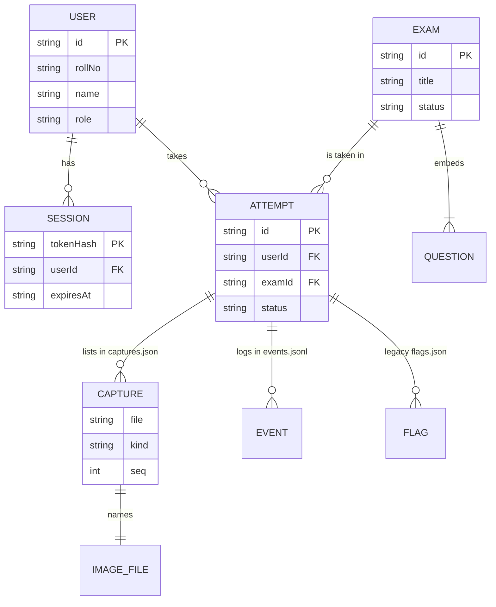
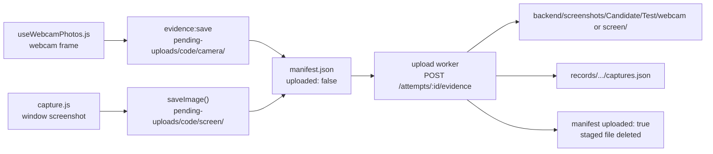

# Athena data and storage reference

Compiled 2026-10-25. Facts are cited to file paths in this repository (and function names where useful); record shapes were also checked against a throwaway server seeded into a scratch folder.

---

## Summary

Athena keeps all of its data as plain files on two machines. The server (`backend/`) holds four JSON files in `backend/data/` (users, sessions, exams, attempts), a folder of per-attempt records in `backend/data/records/<userId>/<attemptId>/`, and every exam image in `backend/screenshots/<Candidate_Name>/<Test_Name>/{webcam,screen}/` (`backend/config.js`, `backend/lib/store.js`, `backend/lib/attemptFiles.js`). There is no database server. Each student's Mac holds a small settings file, an encrypted session token, a durable queue of unsent answers and a staging folder of images waiting to upload, all in Electron's per-user `userData` folder (`app/electron/settings.js`, `session.js`, `queue.js`, `evidence.js`).

Three facts matter most for anyone running or grading the app. First, the server writes every JSON file atomically (temp file, then rename) and serialises writes, so a crash leaves the previous version intact, but the files are only safe with a single server process (`writeFileAtomic()` and `enqueue()` in `backend/lib/store.js`). Second, `npm run seed` wipes the four JSON files and the records folder but never touches `backend/screenshots/` (`clearData()` in `backend/scripts/seed.js`). Third, the screenshots are photos of students' faces and screens, stored unencrypted on the server's disk and kept out of git only by `.gitignore`.

Proctoring (face detection, flags, risk scores) was removed on 2026-10-25. Some stored fields and the `flags.json` record file belong to it; they are marked as legacy where they appear.

---

## Where everything lives

This table is the map for the rest of the document: one row per kind of data, where it is, its format, and whether `npm run seed` resets it.

| Data | Location | Format | Written by | Reset by seed |
|---|---|---|---|---|
| Accounts | `backend/data/users.json` | JSON array | `backend/lib/users.js`, `auth.js` | yes |
| Sessions | `backend/data/sessions.json` | JSON array | `backend/lib/auth.js` | yes |
| Exams and their questions | `backend/data/exams.json` | JSON array | `backend/lib/exams.js`, `examQuestions.js` | yes |
| Attempts and answers | `backend/data/attempts.json` | JSON array | `backend/lib/attempts.js`, `finalize.js`, `review.js`, `events.js` | yes |
| Image list per attempt | `backend/data/records/<userId>/<attemptId>/captures.json` | JSON array | `backend/lib/evidence.js` | yes |
| Event log per attempt | `.../<attemptId>/events.jsonl` | one JSON object per line | `backend/lib/events.js`, `review.js` | yes |
| Flags per attempt (legacy) | `.../<attemptId>/flags.json` | JSON array | `backend/lib/events.js` | yes |
| Seed passwords | `backend/data/seed-credentials.txt` | text, mode 0600 | `backend/scripts/seed.js` | rewritten |
| Exam images | `backend/screenshots/<Candidate_Name>/<Test_Name>/{webcam,screen}/*.jpg` | JPEG | `backend/lib/evidence.js` | **never** |
| Client settings | `<userData>/settings.json` | JSON object | `app/electron/settings.js` | n/a |
| Client session token | `<userData>/session.bin` | `safeStorage`-encrypted bytes | `app/electron/session.js` | n/a |
| Unsent answers | `<userData>/queue.json` | JSON object | `app/electron/queue.js` | n/a |
| Images waiting to upload | `<userData>/pending-uploads/<attemptCode>/` | JPEG plus `manifest.json` | `app/electron/evidence.js` | n/a |

Source: `FILES` in `backend/lib/store.js`; `attemptPath()` and `imagePath()` in `backend/lib/attemptFiles.js`; `loadConfig()` in `backend/config.js`; the client modules named.

`DATA_DIR` moves `backend/data/` (records included) and `EVIDENCE_DIR` moves `backend/screenshots/`; the server refuses an `EVIDENCE_DIR` at the file-system root (`readEvidenceDir()` in `backend/config.js`). The server creates both folders at startup, so the screenshots folder exists before the first exam (`start()` in `backend/server.js`, `init()` in `backend/lib/store.js`). `start.sh` also runs `mkdir -p backend/screenshots`.

The diagram shows how the records refer to each other. Questions are embedded inside their exam; every other link is by id.



Source: record builders `newStudentRecord()` (`backend/lib/users.js`), `createSession()` (`backend/lib/auth.js`), `createExam()` (`backend/lib/exams.js`), `newAttempt()` (`backend/lib/attempts.js`), `uploadEvidence()` (`backend/lib/evidence.js`).

An image file is linked to its attempt only through the `file` value in that attempt's `captures.json` and through the candidate and test names in its folder path. Nothing on disk records the attempt id inside the image folder.

---

## How the server writes files

The store is the one module that touches the four main JSON files, and it is built so a crash can never leave a half-written file. A reader should understand its four rules before editing any data by hand.

**Load once, serve from memory.** At startup `init()` reads each of the four files into an in-memory cache. A missing file starts as an empty array; a file that is not a JSON array stops the server. After that, `read(name)` returns the cached array and never goes back to disk (`init()` and `read()` in `backend/lib/store.js`).

**Write atomically.** `update(name, fn)` calls `fn` with the current array, and `fn` must return a new array. The store writes it, pretty-printed with two-space indentation, to `<name>.json.tmp`, renames that over `<name>.json`, and only then swaps the cache. If `fn` returns the same array, nothing is written (`update()` and `writeFileAtomic()`). A rename within one folder is atomic, so a reader of the file sees either the old or the new version. The store does not call `fsync`, so a power cut right after a write could still lose that last write on some file systems.

**Serialise writes per file.** Each file has its own promise chain, so two updates to `attempts.json` run one after the other, and a failed update does not block the next (`enqueue()`).

**Freeze everything handed out.** Records from the cache are deep-frozen, so a bug that tries to change a record in place throws instead of silently corrupting the cache (`deepFreeze()`).

The per-file queue protects one write, but a request often reads an attempt, decides, and writes it back. `backend/lib/locks.js` adds a second layer for that: `withLock(key, task)` runs tasks with the same key one at a time. The key is the attempt id for answers, heartbeats, events, uploads, submit and admin actions, and `start:<userId>:<examId>` for starting an attempt, which stops a double click from creating two attempts (`startAttempt()` in `backend/lib/attempts.js`). Idle chains are deleted so the map does not grow (`withLock()`).

Both layers live inside one Node process. Two servers pointed at the same `DATA_DIR` would overwrite each other's changes. Editing a JSON file by hand while the server runs has a similar effect: the server keeps using its cached copy and overwrites the edit at its next write to that file. Stop the server, edit, then start it again.

The per-attempt record files follow the same pattern with small differences. `captures.json` and `flags.json` are written atomically through the same queue, keyed by file path (`writeJsonFile()`). `events.jsonl` is appended to with `appendFile`, which is not atomic: a crash in the middle of an append could leave a partial last line, and `readLines()` would then fail to parse the file, which would break the admin attempt detail for that attempt. Missing record files read as empty (`readJsonFile()`, `readLines()`).

---

## The four JSON files

Each file is a JSON array of records. The examples below use synthetic values with the real field names and order. Ids are `<prefix>_<uuid>` (`newId()` in `backend/lib/ids.js`); all times are ISO 8601 in UTC (`iso()` in `backend/lib/clock.js`).

### users.json

One record per account, admin or student. Passwords are stored as an scrypt hash with a per-user salt, never in plain text (`hashPassword()` in `backend/lib/auth.js`). Roll numbers are unique, compared case-insensitively (`findByRollNo()`).

```json
{
  "id": "us_3f1c9a2e-7b44-4c1d-9a0e-2d5b8c6f1a90",
  "rollNo": "23CS017",
  "name": "Dev Khanna",
  "role": "student",
  "salt": "9c1e4b7a2d3f5e6a8b0c1d2e3f4a5b6c",
  "passwordHash": "4a7f...128 hex characters...e21b",
  "active": true,
  "createdAt": "2026-10-25T16:00:00.000Z",
  "lastLoginAt": "2026-10-25T16:50:12.345Z"
}
```

| Field | Meaning |
|---|---|
| `role` | `admin` or `student` |
| `salt`, `passwordHash` | 16-byte salt and 64-byte scrypt key, both hex |
| `active` | `false` blocks login (`ACCOUNT_INACTIVE`) and ends every session |
| `lastLoginAt` | Set at each successful login; `null` until then |

Source: `newStudentRecord()` in `backend/lib/users.js`; `makeUser()` in `backend/scripts/seed.js`; `createSession()` in `backend/lib/auth.js`.

### sessions.json

One record per signed-in token. The token itself is never stored, only its SHA-256 hash, so this file cannot be used to sign in (`hashToken()` in `backend/lib/auth.js`). Expired sessions are removed whenever a new session is created and when an expired token is used; logout removes one session; turning a student off or resetting the password removes all of theirs.

```json
{
  "tokenHash": "740dc2db05dd9983371609a55386876a0edf5b46f80e9f8e0c822b27756ae0ef",
  "userId": "us_3f1c9a2e-7b44-4c1d-9a0e-2d5b8c6f1a90",
  "createdAt": "2026-10-25T16:50:12.345Z",
  "expiresAt": "2026-10-26T04:50:12.345Z"
}
```

Source: `createSession()`, `logout()`, `endSessionsFor()`, `requireAuth()` in `backend/lib/auth.js`. `expiresAt` is `createdAt` plus `TOKEN_TTL_HOURS` (12 by default, `backend/config.js`).

### exams.json

One record per exam, with its questions embedded in order. This record includes answer keys, so it never goes to a student as is; the student routes build key-free views from it (`studentQuestion()` in `backend/lib/questions.js`). The example shows one question; the `proctoring` object is the `standard` preset.

```json
{
  "id": "ex_8d2b6f0e-1a3c-4e5f-9b7d-0c1e2f3a4b5c",
  "code": "VIV-01",
  "title": "Viva Demo Exam",
  "description": "A short demo for the viva.",
  "status": "published",
  "durationMinutes": 20,
  "opensAt": "2026-10-25T16:00:00.000Z",
  "closesAt": "2026-11-01T16:00:00.000Z",
  "maxAttempts": 1,
  "shuffleQuestions": true,
  "shuffleOptions": true,
  "instructions": "Answer every question.",
  "terms": "Athena platform terms (sample) ...",
  "termsUpdatedAt": "2026-10-25T15:55:00.000Z",
  "resultPolicy": { "visibility": "after_submit", "passPercent": 40, "holdAutoEnded": true },
  "resultsPublishedAt": null,
  "publishedAt": "2026-10-25T15:58:00.000Z",
  "proctoring": {
    "enabled": true,
    "preset": "standard",
    "autoEnd": { "enabled": true, "maxFlags": 5 },
    "screenshots": { "minSec": 45, "maxSec": 60, "onFlag": true },
    "cameraPhotos": { "withScreenshots": true },
    "blockMultipleDisplays": true,
    "rules": {
      "fullscreen": { "on": true, "counts": true, "warn": true },
      "focus": { "on": true, "counts": true, "warn": true, "minAwaySec": 1.5 },
      "displays": { "on": true, "counts": true, "warn": true },
      "camera": { "on": true, "counts": true, "warn": true },
      "noFace": { "on": true, "counts": true, "warn": true, "afterSec": 5 },
      "multiFace": { "on": true, "counts": true, "warn": true },
      "power": { "on": true, "counts": true, "warn": true },
      "idle": { "on": true, "counts": false, "warn": true, "afterSec": 120 },
      "clipboard": { "on": true, "counts": true, "warn": true, "blockCopyPaste": true, "blockContextMenu": true }
    }
  },
  "questions": [
    {
      "id": "qn_5a6b7c8d-9e0f-4a1b-8c2d-3e4f5a6b7c8d",
      "type": "single",
      "text": "Which command prints the current working directory?",
      "marks": 2,
      "topic": "Shell basics",
      "explanation": "`pwd` means print working directory.",
      "config": { "options": [ { "id": "op_1a2b3c4d5e", "text": "`ls`" }, { "id": "op_6f7a8b9c0d", "text": "`pwd`" } ] },
      "key": { "optionId": "op_6f7a8b9c0d" }
    }
  ],
  "createdAt": "2026-10-25T15:50:00.000Z",
  "updatedAt": "2026-10-25T15:58:00.000Z"
}
```

| Field | Meaning |
|---|---|
| `status` | `draft` or `published`; questions are locked while published |
| `opensAt`, `closesAt` | The window in which attempts can start; `null` on a new draft |
| `termsUpdatedAt` | Changes when `terms` changes; its date is the `termsVersion` shown to students |
| `resultPolicy.visibility` | `after_submit` (results at submit) or `after_publish` (when the admin publishes) |
| `resultPolicy.holdAutoEnded` | Legacy: held results of attempts ended at the flag limit |
| `resultsPublishedAt` | Set once when the admin publishes results |
| `proctoring.screenshots.minSec`, `maxSec` | Still used: the capture interval in seconds |
| `proctoring.rules.clipboard` | Still used: blocks copy, paste and the context menu in the exam room |
| `proctoring.enabled` | Still used: decides whether consent to capture and events is required |
| rest of `proctoring` | Legacy, unused since 2026-10-25 |
| `questions[].config`, `key` | Shape depends on `type`; see `docs/API.md`, "Question types and scoring" |

Source: `blankExam()` and `createExam()` in `backend/lib/exams.js`; `PRESETS` and `rulesFor()` in `backend/lib/proctoring.js`; `parseQuestion()` in `backend/lib/questions.js`; `app/electron/capture.js`; `app/src/features/exam/useClipboardBlock.js`; `checkConsent()` in `backend/lib/attempts.js`.

### attempts.json

One record per attempt: who, which exam, the shuffled order the student saw, every saved answer, timing, and the final score. It is the busiest file, written on every saved answer and every heartbeat (`saveAnswer()` in `backend/lib/attempts.js`, `heartbeat()` in `backend/lib/events.js`).

```json
{
  "id": "at_98b6dea6-ab2c-4839-a173-1d30026ec0a8",
  "examId": "ex_8d2b6f0e-1a3c-4e5f-9b7d-0c1e2f3a4b5c",
  "userId": "us_3f1c9a2e-7b44-4c1d-9a0e-2d5b8c6f1a90",
  "code": "ATH-DX9A-KNST",
  "attemptNo": 1,
  "status": "submitted",
  "submitReason": "student",
  "startedAt": "2026-10-25T16:51:29.000Z",
  "deadlineAt": "2026-10-25T17:11:29.000Z",
  "submittedAt": "2026-10-25T17:05:10.000Z",
  "lastSeenAt": "2026-10-25T17:05:02.000Z",
  "questionOrder": ["qn_5a6b7c8d-9e0f-4a1b-8c2d-3e4f5a6b7c8d"],
  "optionOrder": { "qn_5a6b7c8d-9e0f-4a1b-8c2d-3e4f5a6b7c8d": ["op_6f7a8b9c0d", "op_1a2b3c4d5e"] },
  "answers": {
    "qn_5a6b7c8d-9e0f-4a1b-8c2d-3e4f5a6b7c8d": {
      "response": { "optionId": "op_6f7a8b9c0d" },
      "revision": 2,
      "timeSpentSec": 12,
      "marked": false,
      "marksAwarded": 2,
      "savedAt": "2026-10-25T16:52:40.000Z"
    }
  },
  "resultVisibleAt": "2026-10-25T17:05:10.000Z",
  "faceDetection": "ok",
  "flagCount": 0,
  "flagAllowance": 0,
  "remainingSecAtEnd": 379,
  "score": 2,
  "maxScore": 2,
  "risk": { "score": 0, "level": "low", "reasons": [] },
  "review": { "status": "pending", "note": "", "by": null, "at": null },
  "consent": { "capture": true, "events": true, "terms": true, "termsVersion": "2026-10-25", "at": "2026-10-25T16:51:29.000Z" },
  "systemCheck": { "camera": "ok", "displays": 1 },
  "sensors": { "fullscreen": true, "focused": true, "displays": 1, "online": true },
  "heartbeatGaps": [],
  "eventSeqs": [41],
  "identityPhoto": "identity/Dev_Khanna-Viva_Demo_Exam-2026-10-25_22-21-29.jpg"
}
```

| Field | Meaning |
|---|---|
| `code` | Human-readable attempt code `ATH-XXXX-XXXX`, shown on the receipt; also the client staging folder name |
| `status` | `in_progress` or `submitted` |
| `submitReason` | `student`, `deadline`, `admin`, or legacy `flag_limit`; `null` while in progress |
| `deadlineAt` | The earlier of start plus duration and the exam's `closesAt`; moved by admin extensions |
| `questionOrder`, `optionOrder` | This attempt's shuffle; `optionOrder` only has entries for shuffled lists |
| `answers[qid].revision` | Highest revision saved; older revisions are ignored |
| `answers[qid].marksAwarded` | `null` until submit, then the score for that answer |
| `resultVisibleAt` | When the student may see the result; `null` until then |
| `remainingSecAtEnd` | Seconds left at submit |
| `score`, `maxScore` | Set at submit; `maxScore` is the sum of marks of the questions asked |
| `consent` | What the student agreed to, with the time |
| `sensors`, `lastSeenAt`, `heartbeatGaps` | Last heartbeat values; gaps over 30 s are recorded |
| `eventSeqs` | `seq` values already received, for de-duplication |
| `identityPhoto` | The API `file` value of the identity photo, set on upload |
| `faceDetection`, `flagCount`, `flagAllowance`, `risk`, `review` | Legacy, unused since 2026-10-25; they stay at their defaults |

Source: `newAttempt()` and `saveAnswer()` in `backend/lib/attempts.js`; `scoredAttempt()` and `finishAttempt()` in `backend/lib/finalize.js`; `withHeartbeat()` and `ingest()` in `backend/lib/events.js`; `saveCapture()` in `backend/lib/evidence.js`; `withVisibility()` in `backend/lib/visibility.js`.

The record grows with use. Every answer save rewrites the whole `attempts.json` file, which is fine at class size (tens of attempts) and would become slow with thousands.

---

## Per-attempt records

Each attempt gets a folder `backend/data/records/<userId>/<attemptId>/`, created on its first write. The folder path is built only from ids that match the id pattern, and every path is checked to stay inside the records root (`attemptPath()` and `insideRoot()` in `backend/lib/attemptFiles.js`). These files hold the parts of an attempt that grow without bound, so `attempts.json` stays small.

### captures.json

The list of every image the server accepted for this attempt, in arrival order. The `file` value is how the API names the image, as `<kind>/<file name>`; the folder on disk is `webcam/` for `camera` and `identity`, and `screen/` for `screen`.

```json
[
  { "file": "identity/Dev_Khanna-Viva_Demo_Exam-2026-10-25_22-21-29.jpg", "path": "Dev_Khanna/Viva_Demo_Exam/webcam/Dev_Khanna-Viva_Demo_Exam-2026-10-25_22-21-29.jpg", "kind": "identity", "seq": 1, "capturedAt": "2026-10-25T16:51:29.120Z", "reason": "identity", "receivedAt": "2026-10-25T16:51:29.400Z", "bytes": 48213 },
  { "file": "screen/Dev_Khanna-Viva_Demo_Exam-2026-10-25_22-21-32.jpg", "path": "Dev_Khanna/Viva_Demo_Exam/screen/Dev_Khanna-Viva_Demo_Exam-2026-10-25_22-21-32.jpg", "kind": "screen", "seq": 2, "capturedAt": "2026-10-25T16:51:32.050Z", "reason": "interval", "receivedAt": "2026-10-25T16:51:32.600Z", "bytes": 151002 },
  { "file": "camera/Dev_Khanna-Viva_Demo_Exam-2026-10-25_22-21-32.jpg", "path": "Dev_Khanna/Viva_Demo_Exam/webcam/Dev_Khanna-Viva_Demo_Exam-2026-10-25_22-21-32.jpg", "kind": "camera", "seq": 3, "capturedAt": "2026-10-25T16:51:32.410Z", "reason": "interval", "receivedAt": "2026-10-25T16:51:33.100Z", "bytes": 39877 }
]
```

| Field | Meaning |
|---|---|
| `kind` | `screen`, `camera` or `identity` |
| `path` | Where the image was saved, relative to `backend/screenshots/`. Fixed at save time, so later renames don't move it (`uploadEvidence()` in `backend/lib/evidence.js`) |
| `seq` | The client's manifest sequence number; (`kind`, `seq`) is unique, so a retried upload is not stored twice |
| `capturedAt` | When the client took the picture (client clock), as sent in the upload |
| `reason` | `interval` or `identity` in practice; `flag`, `resume` and `manual` are accepted but not sent by the current app |
| `receivedAt` | Server time of the upload |
| `bytes` | Image size |

Source: `uploadEvidence()` and `saveCapture()` in `backend/lib/evidence.js`; `EVIDENCE_REASONS` in `backend/lib/constants.js`; `app/electron/capture.js` and `app/src/features/exam/useWebcamPhotos.js` for the reasons the app sends.

### events.jsonl

An append-only log, one JSON object per line. Since 2026-10-25 it receives three kinds of lines: `app_quit` when a student quits mid-exam (`confirmQuit()` in `app/electron/exam.js`), and the admin actions `admin_extended` and `admin_ended` (`backend/lib/review.js`). The legacy routes can also write `admin_resumed` and `flag_dismissed`.

```json
{"seq":41,"type":"app_quit","phase":null,"at":"2026-10-25T16:58:03.000Z","receivedAt":"2026-10-25T16:58:04.210Z","questionId":null,"payload":{},"source":"client","flagId":null}
{"seq":null,"at":"2026-10-25T17:00:00.000Z","receivedAt":"2026-10-25T17:00:00.000Z","type":"admin_extended","phase":null,"questionId":null,"payload":{"minutes":5,"reason":"Power cut in lab","from":"2026-10-25T17:11:29.000Z","to":"2026-10-25T17:16:29.000Z"},"flagId":null,"source":"admin","by":"us_0a1b2c3d-4e5f-4a6b-8c7d-9e0f1a2b3c4d"}
```

Client events carry the client's `seq` and an `at` taken from the client timestamp but clamped between the attempt start and the server's now; admin events have `seq: null`, `source: "admin"` and the admin's id in `by`. Source: `toEngineEvent()` and `eventTime()` in `backend/lib/events.js`; `adminEvent()` in `backend/lib/review.js`.

### flags.json (legacy)

The flag list from the removed proctoring. Because the event path still runs the flag engine, this file is created (as `[]`) the first time any event, including `app_quit`, is received for an attempt, which was observed on the test server. With the current app it stays empty. A flag record, if one existed, would have `id`, `flagNo`, `rules`, `types`, `startedAt`, `counted`, `questionId`, `eventSeqs`, `captures` and `dismissed` (`newFlag()` in `backend/lib/flags.js`, `ingest()` in `backend/lib/events.js`).

---

## The screenshots folder

This is the data people look at after an exam, so its layout is fixed and human-readable. During an exam the app saves a screenshot of the Athena window and a webcam photo as a pair: the first pair 3 seconds after the exam opens, then one pair at a random moment every `proctoring.screenshots.minSec` to `maxSec` seconds, 45 to 60 by default. One identity photo is taken before the exam starts (`FIRST_SHOT_MS`, `schedule()` and `DEFAULT_INTERVAL` in `app/electron/capture.js`; `BeginPage.jsx` in `app/src/features/pretest/`). The screenshot is a capture of the Athena window only (`webContents.capturePage()`, at most 1280 px wide, JPEG quality 70), so it never shows other apps and needs no macOS Screen Recording permission (`takeScreenshot()`).

Every image lands at one path pattern:

```
backend/screenshots/<Candidate_Name>/<Test_Name>/{webcam,screen}/<Candidate_Name>-<Test_Name>-<YYYY-MM-DD_HH-mm-ss>.jpg
```

Here is a real tree from one demo attempt: the identity photo at 22:21:29, then the first pair 3 seconds after the exam opened.

```
backend/screenshots/Dev_Khanna/Viva_Demo_Exam/webcam/Dev_Khanna-Viva_Demo_Exam-2026-10-25_22-21-29.jpg
backend/screenshots/Dev_Khanna/Viva_Demo_Exam/webcam/Dev_Khanna-Viva_Demo_Exam-2026-10-25_22-21-32.jpg
backend/screenshots/Dev_Khanna/Viva_Demo_Exam/screen/Dev_Khanna-Viva_Demo_Exam-2026-10-25_22-21-32.jpg
```

The naming rules, each tied to the code that enforces it:

| Rule | Detail | Code |
|---|---|---|
| Candidate and test names | The student's `name` and the exam's `title` as they are at upload time | `imageNames()` in `backend/lib/attemptFiles.js` |
| Cleaning | Every run of characters other than `A-Z`, `a-z`, `0-9` becomes one `_`; leading and trailing `_` are removed; at most 40 characters; an empty result becomes `unknown` | `namePart()` |
| Separator | Because names contain only letters, digits and `_`, the `-` in a file name only separates candidate, test and time | `namePart()`, `freeFileName()` in `backend/lib/evidence.js` |
| Folder by kind | `camera` and `identity` go to `webcam/`; `screen` goes to `screen/` | `IMAGE_FOLDER` in `backend/lib/attemptFiles.js` |
| Time stamp | The upload's `capturedAt` converted to the server's local time zone, as `YYYY-MM-DD_HH-mm-ss` (no colons, which Finder shows as `/`) | `localStamp()` in `backend/lib/evidence.js` |
| Same-second clash | If the name is taken, `_2`, `_3` up to `_99` are tried; after that the upload fails | `freeFileName()`, `MAX_SAME_SECOND` |
| Path guard | The resolved path must sit inside the screenshots root | `insideRoot()` in `backend/lib/attemptFiles.js` |
| Write | Folders are created on demand; the file is written to `.tmp` and renamed | `saveCapture()` in `backend/lib/evidence.js`, `writeFileAtomic()` in `backend/lib/store.js` |

Source: the files named in the last column.

The clash rule is not only for bursts. The identity photo and an interval webcam photo both go to `webcam/`, so if both were taken in the same second the second one gets `_2`; this happened on the test server, where identity, screen and camera uploads with one `capturedAt` became `...22-52-21.jpg` in `webcam/`, `...22-52-21.jpg` in `screen/` and `...22-52-21_2.jpg` in `webcam/`.

The API still names a file by its kind, not its folder: the upload response, `captures.json`, `attempt.identityPhoto`, the live view's `latestScreenshot` and the admin download route all use `<kind>/<file name>`, such as `camera/Dev_Khanna-Viva_Demo_Exam-2026-10-25_22-21-32.jpg` for a file that sits in `webcam/` (`uploadEvidence()` and `readEvidence()` in `backend/lib/evidence.js`).

### Known limitations of the layout

These follow from naming folders by display names rather than ids. They are worth knowing before a real exam.

Two students with exactly the same name, or names that clean to the same text, share one candidate folder. Their images sit side by side, told apart only by time stamps, and `captures.json` in each attempt's records folder is then the only reliable way to tell whose image is whose. The same applies to two exams whose titles clean to the same text. Letters and digits in any script are kept, so a Devanagari name such as "आर्यन शर्मा" becomes the folder `आर्यन_शर्मा/` (checked on 2026-10-25); only a name with no letters or digits at all becomes `unknown/`. Names longer than 40 characters are cut, so two long names with the same first 40 characters collide too (`namePart()` in `backend/lib/attemptFiles.js`).

A second attempt by the same student at the same exam lands in the same folder; this is intended, and the time stamps keep the files apart (comment on `imagePath()`).

Each capture record stores the relative path its image was saved under (`path`, for example `Dev_Khanna/Viva_Demo_Exam/screen/Dev_Khanna-Viva_Demo_Exam-2026-10-25_22-21-32.jpg`), and the admin download reads from that path (`uploadEvidence()` and `readEvidence()` in `backend/lib/evidence.js`, `storedImagePath()` in `backend/lib/attemptFiles.js`). So if an admin renames a student or changes an exam's title after images were saved, the old images stay where they were and still load in the review console, while new images go to a folder under the new name. This was checked on 2026-10-25 by renaming both and downloading the earlier images (HTTP 200). Records written before this change have no `path` and fall back to the current names.

The time stamp comes from the client's `capturedAt`, which the server checks only for format. A student Mac with a wrong clock produces file names with the wrong time; the server's own arrival time is in `captures.json` as `receivedAt`. The conversion uses the server's time zone, so moving the server to another zone changes how later file names read.

---

## Seed data

`npm run seed` (or `node scripts/seed.js`) gives a fresh, known starting point for a demo. It is destructive by design: it removes the current data and creates new accounts with new random passwords every time (`backend/scripts/seed.js`). `start.sh` runs it only when `backend/data/users.json` does not exist, so starting the app again never reseeds.

| What | Seed result |
|---|---|
| Admin | roll number `admin`, name `Exam Admin` |
| Students | 10: `23CS042` Asha Rao, `23CS017` Dev Khanna, `23CS051` Kunal Shah, `23CS033` Neel Patel, `23CS060` Riya Mehta, `23CS008` Aarav Sharma, `23CS021` Isha Verma, `23CS029` Kabir Singh, `23CS045` Meera Iyer, `23CS054` Rohan Das |
| Passwords | Random each run, format `XXXX-XXXX-XXXX` |
| Exams | `CLI-01` CLI Apps (20 min, results after submit, `lenient` preset), `ELE-01` Electron Apps (30 min, after publish, `standard`), `RN-01` React Native (25 min, after publish, `standard`), `SWF-01` Swift Apps (25 min, after submit, `monitor`) |
| Exam window | Opens 5 minutes before the seed ran, closes 7 days after; 1 attempt each; all published |
| Sessions, attempts | Empty |

Source: `STUDENTS`, `EXAMS`, `makeExam()`, `WINDOW_OPENS_EARLY_MS`, `WINDOW_DAYS` in `backend/scripts/seed.js`; `backend/scripts/seed-data/*.js`.

Each seeded exam has 12 questions covering all seven question types, built through the same `parseQuestion()` the admin API uses, and the seed refuses to write an exam that fails the publish checklist (`backend/scripts/seed-data/build.js`, `makeExam()`). The passwords are printed once and written to `backend/data/seed-credentials.txt` with file mode 0600, one line per account (`credentialsText()`, `main()`). That file is gitignored. Calling the exported `seed({ dataDir })` function directly, as the smoke scripts do, does not write the credentials file; only the command-line entry point does.

---

## The Electron side

Each Mac running the app keeps its own files in Electron's `userData` folder. With the default profile that is the app's folder under `~/Library/Application Support/`; Electron names it from `productName` (`Athena`) in `app/package.json`, though this was not checked on a packaged build. Running with `--profile=<name>` moves everything to `~/Library/Application Support/Athena-<name>`, so a student copy and an admin copy can run side by side (`resolveProfile()` and `app.setPath('userData', ...)` in `app/electron/main.js`). The renderer never reads these files; main does all file work.

| File | Content | Written | Safety |
|---|---|---|---|
| `settings.json` | `{ "serverUrl": "http://127.0.0.1:3000", "theme": "system" }` | When the server address or theme changes | Temp file then rename; unreadable file falls back to defaults |
| `session.bin` | The session token, encrypted with `safeStorage` (Keychain-backed on macOS) | At login; deleted at logout or on `UNAUTHENTICATED` | File mode 0600; if encryption is unavailable the token stays in memory only and is never written |
| `queue.json` | Unsent answers and events | Before every send, and on quit | Temp file then rename |
| `pending-uploads/<attemptCode>/` | Staged images and `manifest.json` | Each capture; manifest updated after each upload | Manifest written temp then rename; one write chain per attempt |

Source: `app/electron/settings.js`, `session.js`, `queue.js`, `evidence.js`.

### The offline answer queue

Every answer is written to `queue.json` before it is sent, so a crash, a quit or a dropped network loses nothing; the next launch or reconnect sends the queue in order (`app/electron/queue.js`). Only the newest unsent revision of each question is kept, because the server would ignore older ones anyway (`enqueueAnswer()`). Events get a per-attempt `seq` from a counter shared with heartbeats (`enqueueEvent()`, `nextSeq()`).

```json
{
  "items": [
    {
      "kind": "answer",
      "attemptId": "at_98b6dea6-ab2c-4839-a173-1d30026ec0a8",
      "questionId": "qn_5a6b7c8d-9e0f-4a1b-8c2d-3e4f5a6b7c8d",
      "body": { "revision": 3, "response": { "optionId": "op_6f7a8b9c0d" }, "timeSpentSec": 15, "marked": false },
      "id": "q1761411160000-1"
    }
  ],
  "seq": { "at_98b6dea6-ab2c-4839-a173-1d30026ec0a8": 41 }
}
```

The queue sends one request at a time, oldest first, batching up to 50 consecutive events of one attempt. On a network failure it backs off 1, 2, 4, 8, 16 and then 30 seconds. An item is dropped on errors that a retry cannot fix (`VALIDATION_FAILED`, `INVALID_RESPONSE`, `NOT_FOUND`, `FORBIDDEN`, `TIME_UP`, `ATTEMPT_NOT_ACTIVE`, `IPC_REJECTED`, `PAYLOAD_TOO_LARGE`) and kept for any other error. Before submit, main waits up to 15 seconds for the queue to empty and refuses to submit if it cannot (`BACKOFF_SECONDS`, `PERMANENT_CODES`, `drain()`, `flush()` in `app/electron/queue.js`; `submit()` in `app/electron/api.js`). Sent items are removed from the file; the `seq` counters are never pruned.

### Image staging and the upload manifest

Every image is written to the Mac before it is uploaded, and `manifest.json` doubles as the upload queue (`app/electron/evidence.js`). The folder is named by the attempt code; images go in a subfolder per kind and are named by the UTC capture time and sequence number. This client naming is separate from the server's naming: the server builds its own file name on arrival.

```
<userData>/pending-uploads/ATH-DX9A-KNST/
  manifest.json
  identity/2026-10-25T16-51-29Z_0001.jpg
  screen/2026-10-25T16-51-32Z_0002.jpg
  camera/2026-10-25T16-51-32Z_0003.jpg
```

```json
{
  "attemptId": "at_98b6dea6-ab2c-4839-a173-1d30026ec0a8",
  "attemptCode": "ATH-DX9A-KNST",
  "status": "submitted",
  "nextSeq": 4,
  "entries": [
    { "file": "identity/2026-10-25T16-51-29Z_0001.jpg", "kind": "identity", "seq": 1, "capturedAt": "2026-10-25T16:51:29.120Z", "reason": "identity", "bytes": 48213, "uploaded": true },
    { "file": "screen/2026-10-25T16-51-32Z_0002.jpg", "kind": "screen", "seq": 2, "capturedAt": "2026-10-25T16:51:32.050Z", "reason": "interval", "bytes": 151002, "uploaded": true },
    { "file": "camera/2026-10-25T16-51-32Z_0003.jpg", "kind": "camera", "seq": 3, "capturedAt": "2026-10-25T16:51:32.410Z", "reason": "interval", "bytes": 39877, "uploaded": false }
  ]
}
```

Source: `saveImage()`, `fileNameFor()`, `writeManifest()`, `markSubmitted()` in `app/electron/evidence.js`.

The flow from camera to server folder:



Source: `app/electron/capture.js`, `app/src/features/exam/useWebcamPhotos.js`, `app/electron/evidence.js`, `backend/lib/evidence.js`.

The worker uploads one image at a time, oldest across all attempts first, and keeps going after submit. When the server confirms, the entry is marked `uploaded: true` and the staged JPEG is deleted. On `PAYLOAD_TOO_LARGE`, `VALIDATION_FAILED`, `NOT_FOUND`, `FORBIDDEN` or `IPC_REJECTED` the entry is marked `skipped` with the code and its file is deleted too. On a network failure it retries after 5, 10, 20 and then 30 seconds, and it polls every 30 seconds when idle (`uploadOne()`, `runUploads()`, `SKIP_CODES`, `RETRY_MS` in `app/electron/evidence.js`). Only images for an attempt that main has seen in progress can be staged (`saveEvidence()`), and each must be a JPEG of at most 1 MB (`checkJpeg()`).

Two things are never cleaned up on the Mac. The `manifest.json` files, and the attempt folders that hold them, stay after every image is uploaded, and nothing deletes them. The student Settings page shows only an upload status line, not a delete button (`app/src/features/settings/EvidenceSection.jsx`). The images themselves do not stay: each is deleted from staging once uploaded or skipped. `ATHENA_EVIDENCE_DIR` overrides the staging root, for testing only (`evidenceRoot()`).

---

## Retention and cleanup

Athena has no automatic retention policy: nothing on the server deletes old images or records on a schedule. What survives depends on the seed and on manual deletion, so this section lists both.

| Item | `npm run seed` | Anything else that deletes it |
|---|---|---|
| `users.json`, `exams.json`, `attempts.json`, `sessions.json` and their `.tmp` files | Deleted, then rewritten | Expired sessions are pruned at login and on use |
| `records/` (captures, events, flags) | Deleted | Nothing |
| `seed-credentials.txt` | Overwritten | Nothing |
| `backend/screenshots/` | **Never touched** | Nothing; delete by hand |
| Client `pending-uploads/` images | Not affected | Each image is deleted after upload or skip |
| Client manifests, `queue.json`, `settings.json` | Not affected | `session.bin` is deleted at logout |

Source: `clearData()` in `backend/scripts/seed.js`; `createSession()` and `requireAuth()` in `backend/lib/auth.js`; `uploadOne()` in `app/electron/evidence.js`; `clearSession()` in `app/electron/session.js`.

The seed leaves images alone on purpose: file names carry the capture time, so images from before and after a reseed sit side by side without clashing (comment in `clearData()`). The cost is that after a reseed the old images have no attempt records any more. They can still be browsed in Finder, but the admin review screen cannot show them, because the attempts that listed them are gone.

### Deleting one candidate's images

The server does not need to be stopped, because it keeps no cache of images. Remove the candidate's folder, using the cleaned name as it appears on disk:

```bash
rm -rf "backend/screenshots/Dev_Khanna"                    # every test for this candidate
rm -rf "backend/screenshots/Dev_Khanna/Viva_Demo_Exam"     # one test only
```

If `EVIDENCE_DIR` is set, use that folder instead of `backend/screenshots`. Because of the name-collision limitation above, check first that no other student shares the folder name; if one does, delete individual files by time instead, matching them to the right attempt through that attempt's `captures.json`. Deleting the folder does not update `captures.json`, so the admin review screen will show missing images for that attempt (the download answers `404 NOT_FOUND`). To remove the records as well, delete `backend/data/records/<userId>/<attemptId>/` while the server is stopped; the attempt and answers stay in `attempts.json`.

### Folders from earlier versions

Two other image folders are listed in `.gitignore` but are not written by the current code: `backend/proctorImages/`, used before images moved to `backend/screenshots/`, and a root-level `evidence/` folder from an older client (`.gitignore`; a search of `backend/` and `app/electron/` finds no writer for either). They can be deleted once anything needed from them has been copied.

---

## Privacy

The screenshots folder holds pictures of students' faces and of their exam screens, together with their full names in every folder and file name. This section states plainly how that data is and is not protected.

The images are not encrypted. They are ordinary JPEG files on the server's disk, readable by anyone with access to that account or that disk (`saveCapture()` in `backend/lib/evidence.js` writes the raw bytes). The same is true of the staged copies on each student Mac until they upload. They travel over plain HTTP, which is unencrypted on the network; the default `127.0.0.1` binding keeps that traffic on one machine, but `HOST=0.0.0.0` for a lab exposes it to the local network (`backend/config.js`).

They are kept out of version control only by `.gitignore`, which lists `backend/screenshots/`, `backend/proctorImages/`, `backend/data/records/`, the four JSON data files and `seed-credentials.txt`. A forced `git add -f`, a copy of the folder elsewhere, or a backup tool that ignores `.gitignore` would still pick them up.

Access through the app is limited to admins: only the admin router serves image downloads, file names are checked against fixed patterns, and paths are confined to the screenshots root (`backend/server.js`, `readEvidence()` in `backend/lib/evidence.js`, `insideRoot()` in `backend/lib/attemptFiles.js`). The screenshot covers only the Athena window, not the whole desktop (`takeScreenshot()` in `app/electron/capture.js`). Students consent before starting (`checkConsent()` in `backend/lib/attempts.js`), but the sample terms they agree to (`backend/lib/terms.js`) still describe flags and a local image folder in Settings that no longer exist, so the consent text needs updating to match what is actually captured.

Passwords and tokens are better protected than images: passwords are stored as salted scrypt hashes, the server stores only SHA-256 hashes of tokens, and the client keeps its token encrypted with `safeStorage` (`backend/lib/auth.js`, `app/electron/session.js`). `seed-credentials.txt` is the exception: it holds every seeded password in plain text, protected by file mode 0600 and `.gitignore`.

---

## Related documents

1. `docs/API.md`: the routes that read and write these records, and the response shapes built from them.
2. `docs/ARCHITECTURE.md`: why images are staged on the client, uploaded by main, and named for people rather than ids.
3. `docs/SECURITY.md`: the threat model and the known gaps behind the privacy notes above.
4. `docs/OPERATIONS.md`: running, reseeding and moving `DATA_DIR` and `EVIDENCE_DIR`.
5. `backend/README.md`: environment variables and the backend layout in brief.

---

## Caveats

The record shapes come from the code that builds them and were confirmed on 2026-10-25 against a throwaway server whose data lived in a scratch folder; the real `backend/data/` and `backend/screenshots/` were not opened. The example values are synthetic except the three-file screenshot tree, which is from a real demo run, and the observed `_2` clash. The default `userData` folder name is inferred from `productName` and Electron's documented behaviour, not checked on a packaged build. The note that a partial last line in `events.jsonl` would break the admin detail view is read from the code and was not reproduced. Field-level "legacy" labels mean the current app never changes the field from its default, based on a search of `app/src` and `app/electron`; a client other than the Athena app could still drive them through the API.
