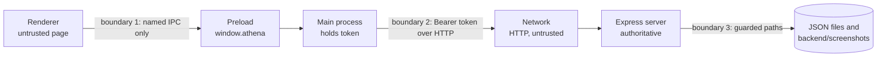

# Athena security: a sandboxed client and a careful server, sent over plain HTTP

Compiled 2026-10-25. Claims about Athena are cited to file paths (and function names) in this repository; claims about Electron and Node.js are cited to their official documentation. The diagram uses Mermaid, which renders on GitHub.

---

## Summary

Athena's security model has one central rule: the web page is untrusted, and only the Electron main process may touch the network, the disk or the login token. The renderer runs sandboxed with context isolation, reaches main only through a fixed preload allow-list, and every IPC handler checks who is calling and validates what it receives (`app/electron/window.js`, `app/electron/preload.cjs`, `app/electron/validate.js`). The server hashes passwords with scrypt, stores only SHA-256 hashes of session tokens, limits login attempts per roll number, validates every body and query against a schema, and guards every file path it builds (`backend/lib/auth.js`, `backend/lib/validate.js`, `backend/lib/attemptFiles.js`).

The weakest points are deployment, not code. Traffic is plain HTTP, so on a lab network the bearer token and every screenshot travel in clear text. Images sit unencrypted on the server and briefly on the student's Mac. The usual way to run the app, `./start.sh`, runs it unpackaged, where several protections are deliberately relaxed for development. The known gaps section at the end lists these plainly.

---

## Threat model: what is worth protecting, from whom

### Assets

The assets, roughly in order of harm if lost, are: exam questions and answer keys before and during an exam (`backend/data/exams.json`); students' answers and scores (`backend/data/attempts.json`); webcam photos and screenshots of identifiable students (`backend/screenshots/`, and until upload `userData/pending-uploads/` on the student's Mac, per `app/electron/evidence.js`); credentials, meaning password hashes (`backend/data/users.json`), plaintext seed passwords (`backend/data/seed-credentials.txt`), and session tokens; and the integrity of the exam clock and of result visibility.

### Actors

A **student** is the main adversary for exam integrity. They control their own Mac, can read files in their user folder, can attach a debugger to an unpackaged app and may try to see the answer key, extend their time, submit for someone else or delete their own screenshots. A **curious classmate on the same network** can sniff or replay traffic if the server is reachable over the LAN. An **examiner** is trusted with all exam data; the code gives every admin access to every exam and image. **Content injected into the renderer**, for example through a rendering bug that let question text run as script, is the threat the Electron hardening is built against. Physical access to the server Mac is out of scope: whoever holds it holds the JSON files.

### Trust boundaries

Source: `app/electron/preload.cjs`, `app/electron/validate.js` (`handle`), `app/electron/api.js` (`request`), `backend/lib/auth.js` (`requireAuth`), `backend/lib/attemptFiles.js` (`insideRoot`).

Boundary 1 separates the page from privileged code. Boundary 2 separates the student's machine from the server, and the server treats everything that crosses it as attacker-controlled, including requests from Athena itself, because a student can replay them with `curl`. Boundary 3 separates request data from the file system.

---

## Controls in the Electron client

### The renderer is sandboxed and isolated, and DevTools are off when packaged

`createMainWindow` in `app/electron/window.js` sets `contextIsolation: true`, `sandbox: true`, `nodeIntegration: false`, `nodeIntegrationInWorker: false`, `webSecurity: true`, `webviewTag: false` and `devTools: !app.isPackaged`. These follow the Electron security checklist items on isolation, sandboxing and Node integration ([Electron, Security](https://www.electronjs.org/docs/latest/tutorial/security)). With context isolation, the page's JavaScript and the preload run in separate worlds, so the page cannot tamper with the preload's objects ([Electron, Context Isolation](https://www.electronjs.org/docs/latest/tutorial/context-isolation)).

The packaged UI is served from a custom `app://athena/` scheme rather than `file://` (`app/electron/protocol.js`). `resolveDistFile` decodes the path, rejects null bytes, resolves it and refuses anything outside `dist/`; only `GET` is allowed, and responses carry `x-content-type-options: nosniff`.

### The preload exposes a fixed list of functions

`app/electron/preload.cjs` exposes `window.athena` with about 30 functions grouped as `api`, `auth`, `server`, `app`, `theme`, `system`, `exam`, `evidence`, `files` and `net`. Each wraps exactly one `ipcRenderer.invoke` channel. `ipcRenderer` is never exposed, listeners receive only the payload (not the event object), and `exam.on` throws for any name not in `EXAM_EVENTS`.

### Every IPC handler checks the sender and validates the payload

All handlers are registered through `handle()` in `app/electron/validate.js`. It first calls `assertTrustedSender`, which accepts a call only when `event.senderFrame.url` starts with `app://athena/`, or, in an unpackaged build only, has the origin of the Vite dev server (`isTrustedSender`). It then runs the handler and converts any thrown error into the `{ ok: false }` envelope; unexpected errors become a generic message so internal details do not reach the page.

Payload checks are hand-written in the same file: `objectPayload` accepts only plain objects, `string` enforces length bounds, `oneOf` enforces enums, `jsonBytes` measures size, and `serverUrl` accepts only `http(s)://host[:port]` with no credentials, path, query or hash. Handlers apply them consistently. For example, `handleLogin` bounds roll number and password to 64 characters (`app/electron/api.js`); `saveEvidence` requires a known, in-progress attempt, `kind` of `camera` or `identity`, and bytes that are under 1 MB and start with the JPEG magic `FF D8 FF` (`app/electron/evidence.js`, `checkJpeg`); `confirmSubmit` requires integer counts (`app/electron/exam.js`); and `system:openPrivacy` maps a two-value enum to fixed `x-apple.systempreferences:` URLs so nothing from the page reaches `shell.openExternal` (`app/electron/system.js`). `system:relaunch` is refused during an exam.

### The renderer can only call routes on an allow-list

`api:request` looks the name up in `ROUTES` in `app/electron/routes.js`, a frozen table of 51 routes. Unknown names are rejected, and the 8 routes marked `internal` (login, logout, me, events, heartbeat, evidence upload, admin image download and CSV export) are refused when the renderer asks for them, because main calls those itself (`app/electron/api.js`, `handleApiRequest`). Path parameters must match `PATH_ID_PATTERN` (`^[a-z]{2}_[A-Za-z0-9-]{8,40}$`) or a special pattern (`kind`, `file`) and are URL-encoded; query values must be scalars; params are capped at 256 KB (`fillPath`, `toQuery`, `MAX_PARAMS_BYTES`). The route table's `role` field is documentation only; the server enforces roles.

### The token never reaches the page and is encrypted at rest

`app/electron/session.js` holds the token in a module variable. To survive a relaunch mid-exam it writes `userData/session.bin` with `safeStorage.encryptString` and file mode `0600`. If `safeStorage.isEncryptionAvailable()` is false, it keeps the token in memory only rather than writing plaintext (`setSession`, `restoreSession`). On macOS, safeStorage uses a key held in the Keychain ([Electron, safeStorage](https://www.electronjs.org/docs/latest/api/safe-storage)). Changing the server address clears the session (`handleServerSet`), and any `UNAUTHENTICATED` reply clears it too (`request`).

### A Content Security Policy limits what the page can load

`app/vite.config.js` injects a CSP meta tag (`contentSecurityPolicy`). In the build it is `default-src 'self'`, `script-src 'self' 'wasm-unsafe-eval'`, `style-src 'self'`, `connect-src 'self'`, `object-src 'none'`, `base-uri 'none'` and `form-action 'none'`, with `blob:`, `data:` and `mediastream:` allowed only for images, media and workers. Because `connect-src` is `'self'`, the page cannot `fetch` the exam server or anywhere else even if a script were injected. In `vite dev`, `'unsafe-inline'` is added to scripts and styles and the Vite WebSocket to `connect-src`.

### Only the camera may be requested, and navigation is locked

`lockDownSession` in `app/electron/window.js` installs a permission request handler that grants only `media` requests whose `mediaTypes` are all `video`; microphone, geolocation, notifications and everything else are denied and logged. `lockDownContents` denies every `window.open`, cancels any `will-navigate` to a URL that is not Athena's own UI (`isOwnUrl`), and blocks `<webview>` attachment. The app is single-instance per profile (`app/electron/main.js`, `requestSingleInstanceLock`), and `--fake-media`, which replaces the camera with a test pattern, makes the packaged app exit (`main.js`).

### Save dialogs and file reads are bounded

`file:openCsv` uses a native open dialog and refuses files over 1 MB; `receipt:savePdf` and `results:exportCsv` always ask where to save in the packaged app (`app/electron/files.js`, `chooseSavePath`). The `ATHENA_SAVE_DIR` shortcut works only unpackaged.

---

## Controls in the Express backend

### Authentication: scrypt, hashed tokens and a login limiter

`backend/lib/auth.js` hashes passwords with Node's `crypto.scrypt`, a 16-byte random salt and a 64-byte key, and compares with `crypto.timingSafeEqual` (`hashPassword`, `verifyPassword`). An unknown roll number is checked against a fixed dummy hash so it takes the same scrypt time as a real one, and both cases return the same message, which blunts account enumeration. Inactive accounts are revealed only after a correct password.

Login creates 32 random bytes as a base64url token; the server stores only its SHA-256 hash, with an expiry of `TOKEN_TTL_HOURS` (default 12, range 1 to 168, per `backend/config.js`). `requireAuth` accepts only a well-formed `Bearer` header, rejects expired sessions and inactive users, and deletes expired sessions when it sees them. Logout deletes the session; resetting a student's password ends all their sessions (`backend/lib/users.js`, `resetPassword`). Generated passwords use `crypto.randomInt` over a 31-character alphabet without look-alike characters, in the form `XXXX-XXXX-XXXX` (`backend/lib/ids.js`, `generatePassword`); admin-chosen student passwords must be 8 to 64 characters (`backend/routes/admin/users.js`).

The login limiter blocks a roll number after 5 failures in 15 minutes, tracking at most 10,000 keys in memory (`backend/lib/constants.js`, `LOGIN_LIMIT`; `auth.js`, `recordFailure`).

### Authorization: role routers and ownership checks

`backend/server.js` mounts admin routes behind `requireAuth` and `requireRole('admin')` and student routes behind `requireRole('student')`, so a student token cannot reach any `/api/admin` path. Every student attempt handler goes through `ownAttempt` (`backend/lib/attempts.js`), which returns `NOT_FOUND` for an unknown attempt and `FORBIDDEN` for someone else's. Results are returned only when `resultVisibleAt` is set (`getResult`), and the student exam view sends no questions before an attempt starts (`backend/lib/studentExams.js`). Admin-only event types such as `admin_ended` are not in the client's allowed list (`backend/lib/constants.js`, `ADMIN_EVENTS`, `CLIENT_EVENT_TYPES`).

### Input validation at every route

Every router that takes ids in its path declares `router.param` checks so any id in a path that does not match `ID_PATTERN` becomes a 404 before a handler runs (`backend/lib/http.js`, `checkIdParam`; for example `backend/routes/attempts.js`). Bodies and queries pass through the schema validator in `backend/lib/validate.js`, which drops unknown keys, trims strings, enforces types, lengths, enums, integer ranges and ISO dates, and stores the cleaned result on `req.valid`. JSON bodies are capped at 256 KB (`backend/server.js`), event lists at 50 items with each free-form payload under 2,000 characters (`backend/routes/attempts.js`, `checkPayloads`), and CSV imports at 500 rows (`LIMITS.IMPORT_ROWS`). The error handler returns a generic `SERVER_ERROR` with a request id and writes the stack only to the server log (`backend/lib/http.js`, `errorHandler`). The request logger records method, path, status and user id, never bodies, query strings, tokens or images.

### Image uploads: type, size and path checks

The evidence route accepts only an `image/jpeg` raw body up to 1 MB (`backend/routes/attempts.js`, `express.raw`), and `assertJpeg` in `backend/lib/evidence.js` rejects empty bodies, oversize bodies and anything not starting with `FF D8 FF` before the disk is touched. `kind`, `seq`, `capturedAt` and `reason` are schema-checked. Admin downloads check `kind` against `EVIDENCE_KINDS` and the file name against `^[A-Za-z0-9_-]{1,160}\.jpg$` (`readEvidence`).

Path traversal is handled in two layers in `backend/lib/attemptFiles.js`. Candidate and test names are reduced to `[A-Za-z0-9_]`, trimmed, capped at 40 characters and never empty, so they cannot contain `.` or `/` (`namePart`). Then every path is built with `path.resolve` and rejected unless it starts with the root plus a separator (`insideRoot`); record paths additionally require both ids to match `ID_PATTERN` (`attemptPath`). The `EVIDENCE_DIR` setting may not be the file-system root (`backend/config.js`). The client applies the same resolve-and-prefix guard to its staging folder (`app/electron/evidence.js`, `inside`).

### CSV formula injection is escaped

`csvCell` in `backend/lib/results.js` prefixes any cell starting with `=`, `+`, `-`, `@`, tab or carriage return with a single quote, so a student named `=HYPERLINK(...)` cannot run a formula when an examiner opens the export in a spreadsheet, and it quotes cells containing commas, quotes or newlines.

### Safe defaults in configuration and storage

The server binds to `127.0.0.1` unless `HOST` is set, validates every environment variable at startup and exits on a bad value (`backend/config.js`). `X-Powered-By` is disabled, and every response carries `X-Content-Type-Options: nosniff` and `Cache-Control: no-store` (`backend/lib/http.js`, `securityHeaders`). Store writes are atomic and cached data is deep-frozen (`backend/lib/store.js`). The seed script writes `seed-credentials.txt` with mode `0600` (`backend/scripts/seed.js`), and `.gitignore` excludes `users.json`, `sessions.json`, `attempts.json`, `seed-credentials.txt`, `backend/screenshots/` and `backend/data/records/`. Ids, tokens, codes and passwords all come from `node:crypto`, never `Math.random` (`backend/lib/ids.js`).

---

## Known gaps

**Transport is plain HTTP.** The default server address is `http://127.0.0.1:3000` (`app/electron/settings.js`, `DEFAULTS`) and the server has no TLS (`backend/server.js`). On loopback this is harmless. Once `HOST` exposes it to a lab network, a classmate on the same network can read bearer tokens, answers, the answer key sent to admins, and every webcam photo and screenshot, and can replay a token until it expires. The client's `serverUrl` accepts `https://`, so a TLS reverse proxy would work without code changes, but none is set up.

**Images are stored unencrypted.** Screenshots and webcam photos are plain JPEG files under `backend/screenshots/`, readable by anyone with access to that folder, with no retention or deletion policy in the code. On the student's Mac they sit in `userData/pending-uploads/` until uploaded, which can be minutes or hours when offline, and a student can delete them there before upload (`app/electron/evidence.js`). Per-attempt records under `backend/data/records/` are also plaintext.

**The usual way to run Athena is the less safe mode.** `./start.sh` launches the Vite dev server and runs `npx electron .` unpackaged (`start.sh`). In that mode DevTools are enabled, the CSP allows inline scripts and styles, `isTrustedSender` and `isOwnUrl` also trust `http://localhost:5173` (or whatever `ATHENA_DEV_URL` says), and `ATHENA_SAVE_DIR` and `--fake-media` work. A student running this way can open DevTools and call `window.athena` directly. The protections described above apply fully only to the packaged build (`npm run dist`).

**Rate limiting covers login only, per roll number.** The limiter keys on roll number, not on client address, so one attacker can try 5 passwords against each of many accounts every 15 minutes, and the counters reset whenever the server restarts (`backend/lib/auth.js`). Other endpoints, including uploads and heartbeats, have no rate limit, so an authenticated student could fill the server's disk with valid 1 MB JPEGs; the server enforces neither a per-attempt image count nor a disk quota.

**The client controls image timestamps.** The file name uses the student-supplied `capturedAt`, checked only as a valid ISO date (`backend/routes/attempts.js`; `backend/lib/evidence.js`, `localStamp`). A modified client could backdate or future-date images. `receivedAt` is recorded server-side in `captures.json` and is the trustworthy time.

**Screenshots show only Athena's window.** `webContents.capturePage` cannot see other apps (`app/electron/capture.js`), and capture runs even for exams whose proctoring preset is `off`, which the settings screen does not make clear. This is a design limit, not a bug, but it bounds what the evidence proves.

**Permission check handler is broader than the request handler.** `setPermissionCheckHandler` returns true for any `media` check, including microphone checks, while the request handler grants only video (`app/electron/window.js`, `lockDownSession`). Actual microphone capture is still denied at the request step, so the effect is limited to permission queries reporting "granted".

**Admin accounts are broad and fixed.** Every admin can read every exam, answer and image; there is no per-exam ownership and no audit log of admin image views. The admin password comes only from the seed script, and there is no route to change it (`backend/routes/admin/users.js` manages students only).

**Leftover proctoring surface.** `'wasm-unsafe-eval'` remains in the CSP for MediaPipe, which now serves only the self-test page (`app/vite.config.js`; `app/src/proctoring/face.js`), and the server still accepts proctoring events such as `no_face` from any student token (`backend/lib/constants.js`, `CLIENT_EVENT_TYPES`). A student replaying requests could post such events to their own attempt and, where the exam's rules are on, raise their own flag count up to an auto-end (`backend/lib/events.js`, `ingest`). That harms only themselves, but it is dead attack surface worth removing.

---

## Further reading

1. [Electron, Security checklist](https://www.electronjs.org/docs/latest/tutorial/security): the source of the window settings and navigation rules above.
2. [Electron, Context Isolation](https://www.electronjs.org/docs/latest/tutorial/context-isolation): why `window.athena` exposes functions, not `ipcRenderer`.
3. [Electron, safeStorage](https://www.electronjs.org/docs/latest/api/safe-storage): how `session.bin` is encrypted.
4. [Electron, webContents](https://www.electronjs.org/docs/latest/api/web-contents): `capturePage`, `setWindowOpenHandler` and `will-navigate`.

The data flow these controls protect is described in [docs/ARCHITECTURE.md](ARCHITECTURE.md).

## Caveats

This document describes the code on the `athena-v2` branch as read on 2026-10-25. No penetration test, dependency audit or fuzzing has been done, so the controls are verified by reading, not by attack. Dependency versions are pinned in `app/package.json`, but the supply-chain risk of `node_modules` has not been reviewed.
